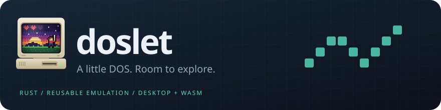
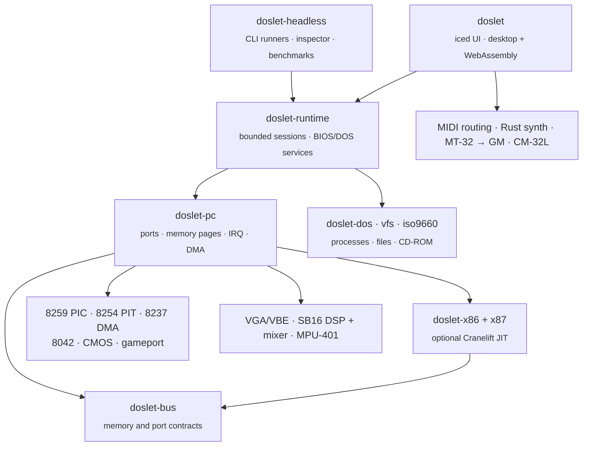

<p align="center">
  
</p>

<h3 align="center">
  A DOS PC emulator written from scratch in Rust.<br>
  One emulation core, in a native window or a browser tab.
</h3>

<p align="center">
  <a href="LICENSE"></a>
  
  
  
</p>

<p align="center">
  <a href="#quick-start">Quick start</a> ·
  <a href="#game-compatibility">Compatibility</a> ·
  <a href="docs/usage.md">User guide</a> ·
  <a href="docs/architecture.md">Architecture</a> ·
  <a href="docs/development.md">Development</a>
</p>

---

Doslet emulates a 386-class DOS PC, including the CPU and x87 FPU, VGA/VESA
graphics, Sound Blaster 16, MPU-401 MIDI and the chips that connect them. Each
part is a small, independent Rust crate. Give it your own copy of a DOS game and
the game starts right away, either in a desktop window or in a browser tab.
The browser version needs no installation and no server.

> [!NOTE]
> **Doslet is in early development.** It already starts real commercial
> protected-mode games with DOS/4GW, SVGA graphics and MIDI music. It is not yet
> a general-purpose DOS emulator. When a game uses something Doslet does not
> implement, the emulator stops and prints a diagnostic instead of guessing.

## Why Doslet

- **One core, desktop and browser.** The same [iced](https://iced.rs) interface
  runs natively on wgpu and as WebAssembly. In the browser, the machine runs in a
  Web Worker and Rust synthesizes the music inside an AudioWorklet, so a
  stalled page does not stop the game or its music.
- **Bring your own game.** Start an EXE with `--game`, or open a ZIP of the
  installation in the browser. The ZIP stays in your browser and is never
  uploaded. By default, Doslet does not change your original files. The game's
  writes go to an overlay that you can keep, export or discard.
- **Chips as crates.** The CPU, x87, PIC, PIT, DMA, keyboard controller, CMOS,
  VGA, SB16 DSP and mixer, MPU-401 and gameport are separate `no_std` libraries,
  each with its own tests. The CPU depends only on a bus contract, not on a PC,
  so the parts can be reused in other projects.
- **Fast where it counts.** A decode cache speeds up the interpreter. On x86-64
  and AArch64, a [Cranelift](https://cranelift.dev) JIT compiles frequently
  executed protected-mode code. Differential tests check both against a
  reference interpreter. Loops that only wait for the VGA retrace are skipped
  ahead instead of being executed step by step.
- **Flexible MIDI.** Play music through the built-in Rust synthesizer, Apple's
  system General MIDI synth on macOS, a MIDI
  port on your computer (TiMidity, Munt or a hardware synth), Web MIDI in the
  browser, or CM-32L emulation that uses your own ROMs. Doslet recognizes MT-32
  music automatically and can translate it for General MIDI devices.
- **A configurable machine.** You can set the RAM size, x87, SB16, MPU-401,
  keyboard and joystick, and mount CD-ROM images (served to the game through
  MSCDEX). Saves can be kept on disk or in the browser's IndexedDB. All of this
  is available in the Settings panel and in TOML launch profiles.
- **Honest about what works.** Regression tests verify that game execution
  allocates no memory after setup. Each game target has a written
  [compatibility report](docs/compatibility/) that separates what has been
  observed from what has not been verified yet.

## Game compatibility

Doslet is developed against real games. Each result below comes from a
recorded run of the actual game, not from a synthetic demo.

| Game | Furthest recorded point | Not verified yet |
| --- | --- | --- |
| [**Machiavelli the Prince**](docs/compatibility/prince.md)<br><sub>DOS/4GW · 640×480 SVGA · MPU-401</sub> | Intro with music on desktop and in the browser; main menu; a scripted new game reaches the Venice map | A full campaign; the original instrument sound |
| [**Civilization**](docs/compatibility/civ.md) 474.03<br><sub>VGA · Roland MT-32</sub> | A new game reaches the Roman map with the first Settler; MT-32 music rendered through CM-32L emulation | Long campaigns; AdLib and Sound Blaster music |
| [**Heroes of Might and Magic**](docs/compatibility/heroes.md)<br><sub>CD image · VESA</sub> | Passes the CD check and plays the publisher intro at 640×480; SETUP reaches its menus | Gameplay |

Doslet does not include any games or synthesizer ROMs. Use copies you own.

## Quick start

Doslet builds with Rust 1.99. The easiest way to get the pinned toolchain is
with [mise](https://mise.jdx.dev/). Run this in your checkout:

```sh
mise install rust
```

On Debian or Ubuntu, the desktop app also needs a C toolchain and the ALSA and
udev headers:

```sh
sudo apt install build-essential pkg-config libasound2-dev libudev-dev
```

### On the desktop

```sh
# Open the workspace, then press Run to start the built-in demo
cargo run -p doslet --release --locked

# Start your own game directly
cargo run -p doslet --release --locked -- --game path/to/GAME.EXE
```

The game's directory becomes drive C:. Click the picture to capture the mouse,
and press **Esc** to release it. `--help` lists the audio, MIDI, MT-32 and
machine options.

### In the browser

```sh
mise install rust cargo:trunk cargo:wasm-bindgen-cli github:WebAssembly/binaryen
mise run web
```

Open <http://127.0.0.1:8080>, choose **Open… → Choose ZIP…**, select the
game's EXE and press **Start game**. `mise run web-build` builds a static
bundle in `web/dist`. It needs no backend.

### Without a window

```sh
cargo run -p doslet-headless --locked -- demo --frame /tmp/doslet-demo.ppm
cargo run -p doslet-headless --locked -- inspect path/to/GAME.EXE
```

The [user guide](docs/usage.md) covers launch profiles, saves, MIDI routing,
MT-32 ROMs and the Linux desktop launcher.

## Under the hood

Each box below is a separate crate. The emulation libraries are `no_std`, use
static bus dispatch in hot paths and never access the host directly. Windows,
files, audio and the network are handled by the frontends.



- **One owner per machine.** Guest RAM and VRAM are borrowed, never cloned on
  each step, and execution allocates nothing after setup.
- **Bounded batches.** The guest runs in finite slices, and even `REP MOVS`
  yields between them. Guest time comes from emulated clocks, never from the
  host's refresh rate.
- **No silent gaps.** An unsupported instruction, port or service stops
  execution with a diagnostic.

The [specification](docs/SPEC.md) and the [architecture notes](docs/architecture.md)
describe these design rules in detail.

## Roadmap

- Wider CPU coverage: paging, precise faults and the full privilege model
- Sound Blaster digital audio and OPL (AdLib) music in host output
- More VGA/SVGA modes and register-level effects
- A fuller DOS kernel and support for more DOS extenders
- MT-32 ROM selection and launch profiles in the browser
- More games verified beyond startup, into actual gameplay

## Development

```sh
cargo fmt --all --check
cargo clippy --workspace --all-targets --locked -- -D warnings
cargo test --workspace --locked
cargo check -p doslet -p doslet-time -p doslet-executable --target wasm32-unknown-unknown --locked
cargo check -p doslet-web-worker -p doslet-web-audio --target wasm32-unknown-unknown --locked
```

All tooling is Rust-based: Cargo builds the native app and
[Trunk](https://trunkrs.dev/) builds the browser app. Builds, tests and CI do
not use Node.js or npm. The [development guide](docs/development.md) covers
benchmarks, profiling, browser tests and the native JIT.

Bug reports and compatibility notes are welcome. Please include the game and its
version, and the diagnostic that Doslet printed.

## License

Doslet is licensed under [GPL-2.0-or-later](LICENSE). Files that include
third-party code keep their original copyright notices, and third-party
libraries keep their own licenses. The vendored iced patches are MIT-licensed;
see the [vendor notes](vendor/README.md). The demo program included with Doslet
is original. The commercial games named above are external test inputs and are
not distributed with Doslet.
