# Component architecture

Doslet separates architectural CPU behavior, chip behavior, machine wiring and
application policy. Libraries live in nested domains, with independent manifests
and tests. No emulation library depends on iced or accesses a host filesystem.

The [machine design](design/configurable-machines.md) and its
[input and overlay extension](design/input-and-write-overlays.md) record the
design decisions. The initial implementation now includes device registration,
version-2 profiles, the shared machine editor, positional ISO sources, input
routing and transactional save stores. SQL remains a future host adapter.
See [configuration](configuration.md) for the implemented settings and limits.

TOML launch profiles use a shared native/browser `toml_edit` codec.
The frontend merges explicit CLI options, resolves host paths and transfers
mounted file ownership during setup. `Session::configure_launch` accepts DOS
command-tail and working-directory byte slices before execution; the CPU and
chip graph does not depend on TOML. The desktop retains launch settings for Reset.

`doslet-storage` defines bounded positional reads, source identities, request
epochs and atomic commit messages. `doslet-iso9660` parses either an owned
immutable image or a cached positional provider. Its DOS file and MSCDEX paths
share one cache. `doslet-vfs` owns the directory tree, changed 4-KiB chunks and
96-handle table. The DOS facade retains the existing mount API. Native directory
and ZIP mounts enter at the filesystem layer; they do not pretend to be sectors.

The native host worker performs file/HTTPS reads and durable save publication.
A browser storage Worker owns IndexedDB transactions and Web Locks; the machine
Worker performs Fetch/Blob reads and owns the cache. Host completions carry an
epoch, generation, request ID and slot. The runtime retains an explicit service
continuation across a miss or commit. It stages reads before guest writes and
copies at most 4 KiB per visit. Guest clocks freeze during storage waits; host
presentation remains responsive. A failed write remains dirty and exportable.

`doslet-config` separates portable machine intent from host bindings. Setup
resolves available components and compiles independent port read/write maps,
page routing, IRQ grants and DMA grants. Concrete endpoint enums preserve static
dispatch in execution. A candidate machine is installed only after validation
and host preparation; Reset uses the active recipe. Hardware options include
4/8/16/32-MiB RAM, x87, SB16, MPU-401, BIOS/AT input and the optional gameport.

`doslet-input` owns bounded contributor-aware key, button and axis routes.
Native gilrs and browser Gamepad adapters normalize host input; disconnection,
focus loss, pause and overflow release affected contributors. The independent
AT keyboard crate implements scan sets 1/2 and guest-time typematic. Its IRQ1
shim updates the BIOS key ring only when executed through the guest IVT.
The gameport implements guest-time charge deadlines at port 201h.

The native UI uses its 16-ms timer only while execution is running or storage
is pending. Otherwise, the controller worker wakes it through coalesced event
notifications. During execution, the existing timer drains controller events.
A paused session with no pending work does not request periodic UI updates.
Guest VGA timing remains independent of this host timer.

## Dependency graph

Arrows mean "depends on".

```mermaid
graph TD
  UI[iced application] --> Runtime[doslet-runtime]
  UI --> Synth[doslet-midi-synth]
  UI --> Routing[doslet-midi-routing]
  Worker[browser Worker] --> Routing
  Routing --> Translator[doslet-mt32-gm]
  Routing --> Synth
  UI --> Moont[doslet-mt32]
  UI -. macOS .-> Apple[doslet-apple-midi / DLSMusicDevice]
  CLI[headless application] --> Runtime
  CLI --> Synth
  CLI --> Executable[doslet-executable]
  Runtime --> PC[doslet-pc]
  Runtime --> DOS[doslet-dos]
  Runtime --> ISO[doslet-iso9660]
  Runtime --> VFS[doslet-vfs]
  Runtime --> Input[doslet-input]
  Runtime --> Storage[doslet-storage]
  UI --> Config[doslet-config]
  PC --> Config
  DOS --> VFS
  ISO --> Storage
  Runtime --> VGA[doslet-vga]
  Runtime --> CPU[doslet-x86]
  DOS --> CPU
  DOS --> Bus[doslet-bus]
  DOS --> Executable[doslet-executable]
  PC --> CPU
  PC --> Bus
  PC --> VGA
  PC --> PIC[doslet-i8259]
  PC --> PIT[doslet-i8254]
  PC --> DMA[doslet-i8237]
  PC --> Time[doslet-time]
  PC --> MPU[doslet-mpu401]
  PC --> DSP[doslet-sb-dsp]
  PC --> Mixer[doslet-sb-mixer]
  PC --> KBC[doslet-i8042]
  KBC --> Keyboard[doslet-at-keyboard]
  PC --> Gameport[doslet-gameport]
  PC --> CMOS[doslet-mc146818]
  CPU --> Bus
  CPU --> X87[doslet-x87]
  CPU -. native dynamic-core feature .-> JIT[doslet-x86-jit / Cranelift]
  Time[doslet-time: independent clock primitives]
```

## Ownership and borrowing

`Session` owns one boxed `PcMachine`, allocated during setup to bound host stack
usage. Its CPU and `PcBus` are separate fields, so the
CPU can execute with `&mut bus` without interior mutability. The bus owns RAM and
devices. VGA owns its aperture and palette. `IndexedFrame<'a>` borrows those
arrays; Rust prevents mutating VGA while that frame remains borrowed.

`PcBus::ram_view` returns a slice only for ranges wholly in ordinary RAM. A range
crossing the VGA aperture is rejected. Word/dword bus operations borrow one RAM
range when its A20 mapping is contiguous and excludes MMIO. Crossings, address
wrap and out-of-range accesses retain ordered byte operations, including partial
writes before a bus error. Loading copies file bytes into guest
memory once; ordinary execution does not make intermediate memory buffers.

The executable inspector borrows the input file. Its load-module and relocation
table slices point into that file's original buffer. The DOS MZ loader consumes
those views and a caller-supplied ordinary-RAM process range, validates the
layout, writes through `MemoryBus` and initializes process registers. It has no
PC device or filesystem dependency. The runtime selects the available PC RAM
range; the host CLI owns file acquisition and output.

`ReadOnlyDrive` owns preloaded file buffers transferred by the host during setup.
DOS handles are fixed-size records referring to those buffers; reads borrow the
file slice and write through the bus. The DOS memory arena uses 1024 fixed block
records and publishes MCB metadata into guest RAM. A DOS overlay load borrows
the mounted executable, copies its module once and relocates in place without
creating another machine or process.

The browser Worker platform adapter keeps the selected ZIP as immutable compressed
input and mounts the chosen executable's directory during setup. ZIP decoding
and path validation belong to the application, not DOS or chip crates. A new
session owns decompressed file buffers; only the compressed source is shared
between pending selection and the running game's reset source. Reset reimports
the original ZIP and creates a fresh RAM overlay, rather than cloning RAM or
mutated file contents. The local file picker uses browser APIs through Rust
WASM bindings and does not upload input.

The drive owns a fixed current-directory name; relative path resolution uses
stack storage. Changing directories or opening a relative path does not call
the host filesystem or allocate during execution.

The MPU-401 crate owns UART state and a fixed output queue independently of
the CPU, machine and audio host. PC ports 330h/331h route to it. The runtime can
drain MIDI into caller-provided storage. The independent no_std MIDI synthesizer
receives those wire bytes and renders into supplied stereo buffers. Its timeline
maps guest nanoseconds to sample frames; MIDI timestamps currently have bounded
batch resolution. Native CPAL owns a reserved host audio queue and shares only
those frames with the output callback. The machine remains owned by iced state.
In the browser, `doslet-web-worker` exclusively owns the machine and storage.
The window's iced state receives diagnostics and RGBA presentation buffers; it
cannot advance or borrow the machine. Two transferable video buffers are reused;
conversion writes into Worker-owned host storage and iced explicitly copies into
its own image. The Worker allocates no guest buffers during ordinary execution.

`doslet-web-audio` contains only the synth, fixed timed MIDI queue and fixed
scratch buffers. AudioWorklet instantiates a precompiled WASM module at setup.
Its process callback calls Rust and writes from fixed channel views without
allocating sample buffers, growing memory or waiting for another thread. Queue
timestamps and committed-time watermarks prevent playback ahead of emulation;
underflow inserts host silence while retaining guest time. Telemetry is handled
outside process() on a direct Worker port. Sixteen transferable MIDI buffers
bound in-flight traffic; acknowledgements recycle buffers independently of the
window. Fresh connection pools and epochs isolate output replacements. No
SharedArrayBuffer or cross-origin isolation headers are required.

User gestures create/resume audio; context suspension does not stall the guest.
Pause preserves synth state and Reset clears it. The browser glue registers
the processor and connects APIs; synthesis remains Rust. A small TextDecoder
fallback accommodates wasm-bindgen error strings in the worklet global scope.
The Trunk Rust post-build hook builds both extra WASM modules and bindings,
including wasm-opt -O3 in release builds. There is no JS build system.

Native macOS can select `apple`, backed by `doslet-apple-midi`. This host adapter
owns one DLSMusicDevice Audio Unit and renders at most 512 stereo frames per call.
It uses the system GM bank, receives the existing GM/MT-32 routing output and
shares the guest-timed PCM mixer and CPAL queue with the Rust synth. Fixed planar
scratch buffers are interleaved into caller storage; no machine state is shared.
Apple API allocation behavior is outside the emulator's allocation guarantee.
Snapshot replay services the Audio Unit between messages and discards setup PCM
without advancing guest time. Pause preserves the unit and sends silence to the
audio device; Reset replaces the unit. The private FFI module owns creation,
configuration, render and disposal;
the crate denies unsafe code elsewhere. No Audio Unit enters the portable core
or WASM dependency graph.

Host MIDI is an explicit alternate adapter: midir natively, Web MIDI in browsers.
The no_std wire decoder reconstructs complete messages and keeps basic replay
state outside sample synthesis. Native port output bypasses sample generation.
A dedicated native thread owns the midir connection. A preallocated bounded
queue carries complete messages and guest timestamps; a condition variable wakes
the sender at the next deadline or a pause/reset/stop request. The UI executes
up to 80 ms ahead and retains one mutable Session owner. The queue mutex never
covers host IO. Short message storage is inline; bounded SysEx payload ownership
is transferred explicitly. Cancellation removes pending messages and requests
silence before replay, with epochs preventing stale completion statistics.
Output failures latch once and cancel future notes. The inspector reports
dispatch lateness, which does not measure downstream PCM underflow.
Browser host ports receive the same timestamped Worker stream. clear()-capable
ports can schedule through Web MIDI; other ports use a bounded cancelable host
timer queue. Neither adapter assumes an OS synthesizer exists. Audio errors
pause/report once and an output replacement can recover the existing Session.
Host API allocations and presentation copies remain explicit; the machine is
not shared with either audio API. The procedural synth is not
sample-based GM or MT-32 emulation. Optional native `doslet-mt32` uses the
`no_std` moont CM-32L engine with externally supplied, fingerprint-validated
Control v1.02 and PCM ROMs. Its timeline renders bounded blocks and explicitly
resamples 32-kHz output to the host rate. ROM loading and SysEx ownership occur
outside the audio callback. Browser ROM selection remains pending.
Output-switch snapshots use a separate setup path that services moont between
complete MIDI messages and discards the warm-up PCM. This avoids submitting a
snapshot larger than the engine's 4096-event live queue in one burst. The guest
clock and output-frame position do not advance during restoration. Native
synth/dialect switches reuse an already open CPAL stream and clear its old PCM
only after the replacement synth is ready.

The independent `no_std` `doslet-mt32-gm` crate translates the MT-32 MIDI
dialect to GM channel messages without ROM data. It owns a fixed ~23-KiB model
of the SysEx-addressed parameter memory (patch/timbre/rhythm temp, patch and
timbre memory, system area, display) and per-part held-note mappings. Built-in
presets map by number through Doslet's own table; guest-uploaded timbres are
classified by name, then by envelope, waveform and register. Parts 1–8 play on
GM channels 1–8 and rhythm on 10. Translation borrows each framed message,
emits through a caller closure and allocates nothing. It is an approximation,
not LA synthesis. Native and browser applications use `doslet-midi-routing` to
frame messages, maintain original and translated channel state, and select
translation according to the game/output dialects. Roland model-16h SysEx
upgrades GM game mode to MT-32 before a GM output receives it. Other unsupported
SysEx retains the output's explicit error behavior. The procedural synth honors
RPN 0; replay restores its semitone/cents range and current RPN selector.
An MT-32 device reset also sends GM All Sound Off and Reset All Controllers on
the translated channels, clearing sustained voices and restoring expression
before the fresh instrument setup. PCM regression tests cover a muted channel
and a note released under sustain; the native Apple adapter has a separate
expression-reset rendering check.
Written-byte masks in the MT-32 model track DT1 and program/controller side
effects. Raw replay sends a device reset followed by bounded DT1 packets only
for known written ranges, then pitch, expression, sustain and active notes.
It does not copy factory timbre bytes from ROM. Snapshots fit a separate 256-KiB
transport buffer (including fragmented written ranges) and preserve the router's partial wire message across switches.
Native moont uses its GmDevice wrapper in GM mode and its Device in MT-32 mode.
GmDevice approximates GM with CM-32L instruments and eight melodic parts; it is
not a full GM sound bank. Output switches restart voices rather than preserve
voice envelopes and reverb tails.

The session owns the selected DOS mouse-driver state. Host adapters supply
logical pointer coordinates, relative movement and button transitions. The
native iced backend is locally patched to expose winit cursor capture and a
bounded relative-motion task stream (see [vendor notes](../vendor/README.md)).
The browser uses DOM Pointer Lock and Worker messages. The session retains
fractional movement and keeps raw motion counters independent of clamped
logical coordinates. Guest callbacks execute as
far calls through an interrupt wrapper that preserves registers and FLAGS;
protected-mode mouse callbacks remain unsupported. Pointer events do not mutate
VRAM: presentation borrows cursor masks and applies AND/XOR while converting
the indexed frame to RGBA. Text presentation also borrows guest memory and uses
explicit BIOS glyph tables. No guest RAM or VRAM clone is required.

The SB16 DSP and CT1745 mixer have independent `no_std` crates and fixed state.
PC ports 220h-based DSP/mixer accesses route to them. The DSP owns command
parameters and two response bytes; the mixer owns its configuration registers.
The DSP consumes explicit byte/word DMA units and returns stereo PCM/block IRQ
events. A preallocated machine queue owns produced frames until the host drains
them. Full hardware timing and applying mixer gain to audio remain pending.
The absent AWE/EMU8000 probe banks are explicit machine wiring, rather than an
emulated synth. Neither DSP nor mixer depends on the CPU or host audio.

## Chip-to-machine boundary

CPU segment translation leaves the A20 signal to machine wiring. `PcBus` owns
the gate and applies it before RAM/MMIO routing. Fast port 92h, keyboard-controller
output-port events and BIOS services update that signal; the i8042 receives
the resulting line value through an explicit setter. The default machine owns
16 MiB of RAM. Its CMOS memory-size configuration and BIOS query values match
that storage. Device queues and core execution remain fixed/preallocated;
CMOS clock ticking and complete device-event scheduling are still pending.

The CPU also owns a fixed 512-entry decoded-instruction cache for selected
default-32-bit forms. `MemoryBus` optionally supplies side-effect-free code views
and `CodeCheck` values, resolved once when an instruction is decoded. A check
records the RAM owner and mapping generation as one code-space token, plus the
physical 4-KiB pages touched by the instruction and their write generations; a
hit compares that token and both generations without translating the address
again. Every RAM write and borrowed mutable view advances the relevant
generations, so DOS services and wide CPU writes share the same invalidation
path. The PC retains 32 KiB of page generations beside its 16-MiB RAM.
Setup-only atomic owner identities distinguish replacement buses; they contain
no guest state. Checked counters never wrap; exhaustion falls back to
interpretation. A20 changes advance the mapping generation in the token.

Cache entries contain operations, immediates and addressing expressions rather
than resolved data addresses. Register-dependent addresses and segment checks
remain execution work. Entries are keyed by linear address and hold only
default-32-bit decodes, so they survive CS context changes; a change resolves the
selector, hidden-cache, PE-mode and execute checks once, and hits validate the
entire code span's offset range and its generation token. Decoder rejections are
cached against the same check so the original interpreter runs without repeated
decode attempts. Each `Registers` value carries a setup-time
lineage and a CS reload version that are not guest state; a step whose lineage,
version, selector and PE mode match the last resolution skips the full context
comparison, and exhausted counters restore it. Short/noncontiguous code views and unsupported
forms use the original byte-fetching interpreter, preserving partial fault IP
progress. One cached instruction still consumes exactly one bounded step; a
cached REP string performs one iteration per step, and IRQ delivery retains its
existing path. The optional native core below uses a separate block cache.

`Cpu::interpret_batch` runs cached instructions without the native core between
the machine's IRQ check and its next hardware deadline, at most 256 steps, so
the PC advances clocks and counters once per slice instead of once per
instruction. Segment windows are resolved once per slice. Each instruction
validates all of its plain-RAM operands, stack slots and branch targets before
its first effect and then accesses those linear addresses directly; a failed
check ends the slice before that instruction.

The CPU owns hidden segment caches, descriptor-table state and optional x87
state. Its decoder selects 16/32-bit addressing and validates cache permissions
before emitting linear bus addresses. The independent `doslet-x87` crate owns
eight raw extended register encodings, retained 64-bit finite significands,
physical tags, TOP, control/status and instruction/data pointers. It depends on
neither a PC device nor the frontend. The 80387 state is enabled by the PC model.

`doslet-x86::x87_decode` classifies all D8–DF/ModR/M pairs without accessing
guest state or memory. Every documented 387 encoding selects an interpreter
handler; P6/SSE3 and reserved encodings remain separate diagnostics. The adapter
supplies addressing/mode/operand size and performs bus transfers. All numerical
operations and environment encoding remain in `doslet-x87`.

The FPU uses fixed-width integer arithmetic across the extended exponent range.
Raw real80 transfers and context images preserve guest encodings; binary64 is a
diagnostic/output view. Shared arithmetic rules handle memory/register specials.
Root, remainder, logarithm, exponential and trigonometric kernels have bounded
loops and fixed local arrays, without a host math dependency or execution
allocation. FPREM partial reductions return C2 to the guest; trig range failures
also preserve the guest operand and set C2. FNSTENV/FNSAVE side effects occur
after the CPU adapter completes memory writes.
The [coverage map](compatibility/x87.md) separates opcode support from numerical
conformance. The [audit](compatibility/x87-audit.md) records reference fixtures
and the remaining stack/exception-delivery and nonfinite-transcendental limits.

VGA owns configuration register banks and the color/mono CRTC decode. The PC
routes their ports; VGA tests cover readback and write protection independently
of CPU execution. Raster/planar-memory effects remain future work.
Its preallocated 512-KiB VRAM supports a 64-KiB banked aperture and borrowed
640×480 indexed scanout. The runtime's VBE BIOS adapter advertises the supported
mode/window and installs a guest far-call bank switch shim. Mode changes and
bank selection retain one VRAM owner; conversion writes into caller storage.

The PIC and PIT have no bus or CPU dependency. Their methods operate on explicit
port values and clock ticks. The PC adapter chooses their I/O addresses and
connects PIT output periods to the PIC request latch. The machine delivers
eligible interrupts at CPU boundaries with the CPU's STI/SS inhibition state.
Its functional timeline advances four nominal 33-MHz clocks per bounded step,
using 121 ns plus a retained 7/33-ns fraction. Single steps use addition and
carry; batches preserve the same fraction. PIT, selected raster status and DSP
rates retain fractional clock conversion.
The runtime handles cooperative INT 2Fh/1680h yields by returning AL=00h and
ending the current bounded batch after the BIOS shim returns. It exposes the
yield to native and Worker schedulers so they return to their event loops
before executing another batch. The CPU and hardware clock have no host sleep
dependency; a yield does not fast-forward guest time or pause the session.
Interrupt-enabled HLT can combine those same logical steps until the first
PIT/DSP deadline, the remaining budget, or 1 ms of guest time. IRQ eligibility
still takes precedence. VGA accumulates bounded guest nanoseconds and resolves
raster phase when status is read or at its 1-ms flush bound. The PC composition
recognizes confirmed unprefixed `IN AL,DX; AND AL,08h; JZ/JNZ -5` and
`IN AL,DX; TEST AL,AH; JZ/JNZ -5` status waits, with AH=08h for TEST.
The TEST path executes its final iteration normally so unmasked AL bits retain
their exact raster-time value. A CPU-independent bus notification on actual VGA status I/O gates discovery,
so unrelated CPU transfers require no code inspection. VGA exposes an exact
next-retrace deadline with retained pixel fractions;
PC combines it with PIT/DSP deadlines and skips whole three-unit iterations
strictly before an event. Code/segment/port/state checks protect the fast path;
the CPU library has no VGA dependency. IF-disabled waits preserve pending PIC
requests. TF, interrupt shadows, paging, changed code and one-step execution fall
back. A runtime switch disables recognition for reference measurements. Optional
profiling counters are absent from ordinary builds.
An additional opt-in PC path accepts three caller-selected CMP-dword/JNE sites
and a DS-relative operand. The native Heroes experiment supplies its known
addresses outside the chip/CPU libraries. Exact code, mapped ordinary RAM,
positive data, invariant flags and IRQ/debug state are checked per batch.
Whole two-step iterations advance strictly before PIT/DSP events with the same
1-ms bound. The path remains disabled by default and does not patch guest code.
No chip reads a host clock or depends on UI refresh. Precise CPU/bus timing and
complete arbitration/cascading remain future work.

Two independent 8237 instances own address/count/mode/mask state. The machine
owns page registers and byte/word address wiring, including 64/128-KiB wrapping.
Audio DMA reads ordinary physical RAM independently of the CPU A20 line and
commits one unit after the memory access. No intermediate RAM copy is made.

The optional VFS write overlay owns reserved 4-KiB chunks and bounded file
metadata. Read/write opens retain the original input owner; merged reads borrow
base and upper storage. Repeated writes replace existing upper chunks. Truncate
tracks the visible base prefix so extending a shortened file returns zeros.
Whiteouts and renamed entries survive snapshot recovery. A compact extent mode
remains for callers requesting legacy overlay budgets below 4 KiB. The default
library drive stays read-only.

This makes chip tests independent of CPU instruction coverage. Future cards can
compose existing chips without introducing cycles: the Sound Blaster card may
depend on OPL, while the PC machine connects it to DMA and interrupts.

## Native dynamic core

The native frontends enable `dynamic-core` by default on x86-64 and AArch64.
`doslet-x86` remains a `no_std` CPU library with static bus dispatch. Its optional
`doslet-x86-jit` dependency is a host compiler adapter using `std` and Cranelift;
it is excluded from WASM and from builds without the feature. The adapter has
no PC, DOS or filesystem dependency and never owns guest RAM. Its small unsafe boundary
converts finalized compiler output to private function pointers, invokes them
with borrowed general registers, EFLAGS and EIP, optionally borrowing a bounded
RAM span for a trace, and frees executable storage on drop. The rest
of the emulation workspace retains `unsafe_code = forbid`; the macOS Audio Unit
host adapter has its own private FFI boundary described above.

There are two distinct representations. Address-independent prepared blocks
contain decoded register IR or a bounded RAM/control-flow trace and at most 240
expected code bytes. Execution cache
entries bind those blocks to CS state, offset, privilege and a bus `CodeCheck`.
The execution cache has 1024 slots allocated at CPU setup. An independent pool
retains compiled IR by code fingerprint, with full byte comparison before reuse;
execution-cache collisions and address changes do not discard native code.
Pool insertion happens only during explicit preparation. Code discovery performs no
allocation. A hot block becomes eligible after 16 observations; compilation is
explicit host maintenance through `Session::prepare_dynamic`, capped at eight
blocks per call (two in ordinary frontend execution). `Session::advance` never
calls the compiler. Executable storage is split into at most 16 independently
owned Cranelift modules, each holding at most 256 functions (4096 resident
functions total). A trace and its optional register fallback reserve their two
slots in the same module before either is emitted. Native entry and preparation
mark a module recently used. When no module has space, preparation retires the
least recently used module, removes its execution, template and pool handles,
and frees its executable storage before installing replacement code. Hot
modules remain usable; evicted blocks can become eligible again without a
session restart. `DynamicStats::code_cache_evictions` counts retired modules.
Imported templates are eagerly attempted once; eviction alone does not eagerly
recompile cold profile entries. Genuine compiler failures still latch once and
stop further compilation; existing blocks and interpreter fallback remain usable.

The first native subset consists of 2–16 straight-line dword register MOV,
ALU/CMP/TEST, INC/DEC, XCHG and NEG/NOT instructions in protected default-32-bit
code. A terminal short/near relative Jcc/JMP whose target is exactly the block's
start can form a native loop; its branch counts toward the 16-instruction limit.
It shares the existing instruction decoder with the interpreter. Native
code reads/writes eight general registers, EFLAGS and EIP. The register-only
compiler retains its original ABI. I/O, unsupported control transfers, segment
changes, x87, REP and other widths terminate a
block and execute through the interpreter. Whole-block CS checks protect fetch
limits. TF/RF/VM, paging, halted state and interrupt shadows prevent native
execution. Ordinary single stepping stays on the interpreter.

For straight blocks, the compiler tracks arithmetic flag liveness backwards:
only flags needed by a later ADC/SBB or at block exit are materialized. INC/DEC
preserve carry across these chains. Native loops conservatively compute full
arithmetic flags and carry them with the registers through an SSA backedge.
The generated function checks the hardware-bounded remaining step budget before
each whole iteration and returns the actual completed-step count. It writes
architectural state only on return: EIP points to the loop start after a taken
backedge, or after the branch when the condition is false. A budget remainder
smaller than one iteration uses the existing execution path. No guest memory
can change while this register-only loop holds its borrow, so code validation
occurs once on entry, rather than on every iteration.
Generated code stores only changed registers and works directly
on borrowed CPU state, without copying a ten-word temporary at every call.

A separate RAM trace compiler accepts up to 16 reachable instructions
inside one 240-byte code span. It follows relative branches and supports dword
MOV/ALU memory sources with 32-bit base/index/displacement addressing. LEA,
memory-left CMP/TEST, byte MOV/CMP/TEST and byte MOV stores extend the register
scope; AH-style aliases preserve all other bits of their parent dword. Dword
memory XCHG resolves its address and value from the old registers, guards the
load and store, then exchanges operands and updates page generations. In the
single-owner machine the exclusive RAM borrow prevents hardware activity from
interleaving with the exchange. PUSH/POP32,
near direct/indirect CALL and RET/RET imm16 use guarded ordinary-RAM stack
accesses. SS must be full flat with a 32-bit stack; CALL/RET additionally require
full flat executable CS, making their dynamic targets valid offsets. PUSH ESP
uses its old value, POP ESP overrides the incremented pointer, and indirect CALL
reads its target before writing the return address. Every failed guard exits
before the current instruction's register or memory effects. Direct calls follow
known targets and retain return sites during discovery; runtime CALL/RET targets
matching a prepared instruction transfer in SSA, otherwise they return to dispatch.
Discovery uses fixed arrays and rejects overlapping instruction starts. Other
stores, word overrides, far calls/returns and unsupported successors are interpreter exits.
The full contiguous span, including gaps and all branch bytes, is checked for
code generations and CS bounds; external exits receive conservative CS checks.
Every used data segment must be flat, fully readable and cover all 32-bit
offsets; store segments must also be writable. Positive validation is cached
against used selectors and full hidden descriptors within the execution-cache
key (CS, entry IP, privilege and mode). A separately compiled register prefix
remains usable when the larger RAM trace cannot run; it is attempted only after
zero trace progress and fits the same resolved hardware budget. Both functions
occupy slots in the same bounded code bank. Replacing the prepared trace clears the
result. Changed DS/SS state cannot reuse stale assumptions.

`MemoryBus::native_ram` optionally returns `NativeRam` with a borrowed immutable
backing slice, linear base and one excluded interval. Its default declines native
reads. The PC exposes `500h` through the configured RAM end only while A20 is enabled: IVT/BDA stay
outside the span and the VGA aperture is explicitly excluded. Backing bytes in
that interval are never CPU-visible through native access. Each native access
checks the complete byte/dword against the view, exclusion and 32-bit overflow
before forming a host pointer; unaligned dwords use little-endian order. Failed guards return before the load, preserving
prior progress, full flags and EIP. The pointer is never retained between calls.
No device or mapping can change during the immutable borrow.

`MemoryBus::native_ram_mut` optionally supplies `NativeRamMut` with disjoint
exclusive borrows of the RAM backing span and the full physical 4-KiB
page-generation table, with the same mandatory excluded-interval guard. The PC requires A20 enabled and an available code space. Borrowing does
not itself invalidate pages. Generated stores check complete byte/dword bounds,
32-bit overflow, generation-table bounds and non-exhausted counters, and reject
the pages occupied by the active trace (including gaps). A successful store
updates each touched page generation once before further execution. Other
compiled blocks therefore fail their next generation check; self-modifying
stores leave native execution before changing active code. The interpreter
handles the store and invalidation. No pointer survives the exclusive borrow.
The read-only compiler API rejects traces containing stores. The read-only CPU
API may execute their register prefix, but never their stores. Writable execution
requires an exclusive bus borrow.

Trace nodes carry registers, flags and remaining budget in SSA, preserving
state across internal branches/backedges. The first version computes full flags
and checks the remaining hardware-bounded budget per instruction. Every exit
returns the actual completed-step count, including completed native stores. `ram_trace_steps` and `ram_trace_entries` identify this
subset of total native execution. The resident-function limit is shared with
the register-only compiler.

Optional exit diagnostics must be enabled before native compilation. The CPU
allocates 8,192 aggregation slots during setup, then records CS, entry/exit IP,
linear addresses, reason, count and completed steps without execution-time
allocation. Refused entries are separate from actual native returns, including
zero-step guard failures. Profiled traces use a private reason-bearing return
ABI; ordinary generated functions remain uninstrumented. The diagnostic runner
checks guest state against interpretation and exports metadata CSV separately
from timing benchmarks. See [exit measurements](compatibility/native-core.md#measured-native-exit-reasons).

The PC delivers pending eligible IRQs before entering a slice of at most 256
steps, bounded by the caller's budget and strictly before the next PIT/DSP/AT-keyboard
deadline and the 1-ms hardware advance limit. A slice combines native blocks
with decoded ordinary-RAM operations, near branches and stack accesses. The
bus must explicitly guarantee the complete operand spans are writable ordinary
RAM via `MemoryBus::is_plain_ram`; segment, stack and branch bounds are checked
before execution. Faultable accesses, MMIO, I/O, mode/IF changes, REP and other
unsupported forms stop the slice before their effects. The interpreter handles
that boundary instruction with current hardware time and interrupt state.
The PC updates clocks and scheduling counters once per slice. Native execution
counters also accumulate locally, while `Session::advance` commits its total
step count once per host batch. VGA polling candidates retain their existing
per-instruction observation. This reduces interrupt checks without delaying IRQ
delivery. Native blocks that do not fit fall back without native side effects.
Every entry checks page, mapping and owner generations. After a generation change,
identical bytes may rebind existing code; changed bytes require new IR and
compilation. RAM writes inside a slice still invalidate code before the next
instruction/block lookup. No large RAM/VRAM buffer is cloned.

Optional `--core-profile FILE` preparation stores at most 256 observed hot blocks
in a versioned file of at most 62,726 bytes. It records linear address hints and
exact post-relocation code bytes, never host code or pointers. Imports are bounded,
fully decoded and compiled again. Runtime binding decodes the complete current
block and searches the prepared pool by fingerprint plus exact bytes and length;
a historical shorter register prefix cannot pin a newer RAM trace. Address hints
remain format metadata. Byte comparison and the current CS/code checks
are mandatory before a first native entry. Invalid profiles report a warning and
leave ordinary execution available. Profiles currently use observed addresses,
not executable object identities. Identical register code can bind at a new
address, while changed relocation bytes lose a hit and safely rediscover code.
LE/LX static object traversal and relocation-aware
binding remain future work. Profiles may contain proprietary guest code and stay
local, outside the original game directory.

## Service interception

The CPU implements ordinary INT and IRET stack/vector behavior. The runtime
installs BIOS/DOS shims in guest memory and checks arrival at those addresses.
Replacing an IVT entry runs the guest's replacement handler. This avoids teaching
the CPU about INT 10h video modes or INT 21h DOS functions.

The shim region is writable RAM in this bootstrap, not a complete BIOS ROM model.
The runtime also checks its IRET byte before intercepting the service.
Interception is restricted to real mode; protected guest handlers execute through
the CPU's descriptor and interrupt-gate path. Complete ROM protection, exception
behavior and service ABI coverage remain milestones.

## Presentation boundary

The frontend requests a frame only after a bounded execution batch. A revision
number prevents rebuilding an unchanged frame. The initial iced image handle
requires owned pixels, so presentation allocates an RGBA image and moves that
buffer into iced. Handle clones share the underlying image; they do not clone
the emulated machine.

A future shader widget can own reusable GPU textures and accept indexed pixels
plus a palette, reducing CPU conversion and repeated host allocations. GPU upload
still has a transfer cost. That work belongs to presentation and must not change
the chip's borrowed scanout interface.

## Extension rules

- Add a chip crate when there is actual state and behavior to implement. Avoid
  empty crates for every item on the roadmap.
- Keep chip-specific internals under `registers`, `memory`, `timing`, `scanout`
  or equivalent modules as their implementations grow.
- Share bus/time contracts; do not create a catch-all common library.
- Use monomorphized bus access and concrete chip types in execution paths.
- Put filesystem, audio-device, window and Worker adapters in platform code.
- Add another CPU engine behind the architectural-state boundary. Keep a simple
  interpreter as the correctness reference; benchmark before specializing.
- Reserve large buffers and event capacity at setup. Expose overflow explicitly.
