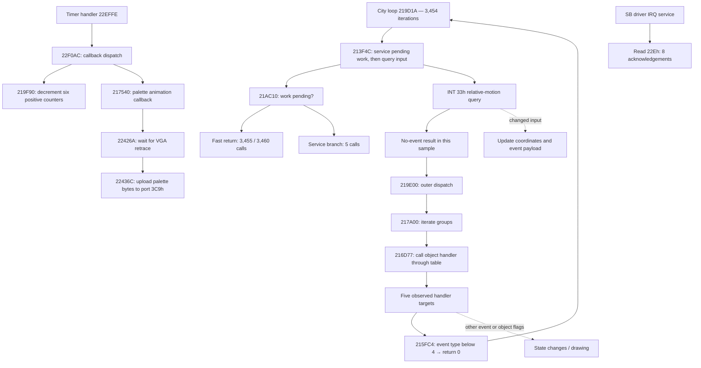

# Speculative graph audit of the Vulcania city snapshot

The snapshot supports **conditional path markers**, but not a single static
"city loop is waiting" label. Most observed repetition is UI dispatch and
handlers returning without accepting an event. The same handlers contain paths
to drawing. Direct VGA polling accounts for only 1.88% of this sample's execution
steps; it cannot explain most of the city's apparent spare capacity.

This is a preliminary analysis of one state, not a new controller or an accepted
CPU-saving result. No guest instructions were patched or skipped.

The follow-up [CPU-budget sweep](city-cpu-sweep.md) compares 1–1000 MHz at fixed
guest duration to identify which of these paths consume additional CPU capacity.

## State and method

- Scene: Vulcania city, confirmed from `target/heroes-states/city.pb.png`.
- Portable fixture: `target/heroes-states/city.pb.gz`.
- Compressed-file SHA-256:
  `512fd0a2df13215b4012bb1ef7715546bbbf1edcdd6131f7720e23ba4710ef4d`.
- Initial PC: `0180:0021BB81`, flat linear `0x21BB81`, configured 133 MHz.
- Interval: guest time 53,929,821,216 through 54,290,723,111 ns:
  **360.902 ms**, 12,000,000 scheduler steps, no injected input.
- Execution: interpreter, JIT/learned waits/VGA acceleration/analyzer/controller
  disabled. Profiling supplies IRQ and port counters for the offline trace.
  Host runtime is not a benchmark of production execution.

The trace records 4,191 distinct `(PC, bitness)` nodes. It separates 98 hardware
IRQ-entry steps from 11,999,902 other steps rather than mistaking IRQ entry for a
branch. Counts include REP microsteps and service execution; they are not host
CPU percentages. No repeated 15-byte instruction window changed during tracing.

The speculative graph starts from 2,432 observed PCs inside the main executable
range `0x19E000..0x23F527`, whose layout is recorded in
[the earlier wait inventory](heroes-waits.md#recorded-scope). It follows both
conditional arms and direct calls from snapshot bytes, including unexecuted
code. Observed indirect targets supplement the graph but leave the target set
open. A call continuation means **may return**, not a proved return path.

| Graph result | Count |
| --- | ---: |
| Decoded instruction nodes | 27,403 |
| Nodes not executed in the sample | 24,971 |
| Edges | 31,028 |
| Conditional edges not observed in the sample | 4,833 |
| Open indirect transfer sites | 51 |
| Service/far-transfer/stop boundaries | 52 |
| Undecodable entries / outside-scope targets | 2 / 1 |
| Nodes involved in overlapping decoding | 18 |

These totals describe a syntactic over-approximation, not feasible-path coverage.
Overlaps and unknown transfers remain review boundaries. Static bytes match the
first observed code windows in the scoped trace. The graph does not fully decode
the 16-bit extender, BIOS and SB driver, prove memory aliasing, or prove callee
purity. REP repetition is represented in runtime counts, not as static self-edges.

## Observed structure

Solid paths below are supported by observed transfers and decoded instructions.
Dashed paths are alternative paths found in the code; they are not permissions
to skip instructions. The diagram groups many instructions into functions or
regions and does not depict every return.



### Dispatch is the dominant repeated structure

`0x219D8F → 0x219D1A` repeats 3,454 times. The outer indirect call at
`0x219E00` reaches `0x1F4189`, `0x21521C` and `0x217A00` 3,454 times each.
`0x217A00` walks groups and calls `0x216D5C`, which walks each group's objects.

The object's callback is loaded through `[object+0x1C]`, then called through
`[table+8]` at `0x216D77`. Starting from the first observed `EAX=0x283674` at
`0x217A00`, resolving **initial snapshot RAM** gives:

| Group address | Objects |
| --- | ---: |
| `0x11798C` | 16 |
| `0x11785C` | 6 |
| `0x1176BC` | 6 |
| `0x06E174` | 21 |

The root's first group is at offset `0x16`; group-next is at `+6`, first child at
`+0x1A`, and child-next at `+4`. The fourth group is in conventional RAM, so an
extended-RAM-only pointer walk would produce a wrong result.

All five snapshot-resolved callback targets also execute:

| Handler target | Calls from `0x216D77` |
| --- | ---: |
| `0x21B99C` | 37,997 |
| `0x21D7B4` | 31,086 |
| `0x21DC00` | 3,454 |
| `0x224008` | 93,274 |
| `0x22CA24` | 3,454 |

The total is 169,265. It differs from `3,454 × 49` because the capture begins and
ends inside dispatch. These targets describe this state; replacement of a list
or callback table must invalidate a reusable summary.

### A concrete candidate for an empty-work marker

At `0x215FC4`, the common path saves registers, loads the event type from `[EDX]`,
compares it with 4, and branches at `0x215FD3` to `0x215FE6`, which returns zero.
That branch is taken **141,631 times**. Its 15 instructions account for
**2,124,465 steps, or 17.70% of the sample**, with no nested call or device access
on that path. Stack stores still occur; this is not a strict no-write loop proof.

Four visits take the other branch. The same function can call an object method
at `0x215FFF`, change state and reach drawing. Speculative expansion also finds
the unexecuted path through `0x21600E..0x21603C`, ending in a call to `0x2129EC`.
Consequently, an unconditional marker covering the whole function is wrong.

The dispatcher `0x216D5C..0x216D93` itself consumes another **1,872,297 steps
(15.60%)**, excluding callees. That is measured dispatch overhead, **not another
15.60% of proved removable waiting**. Its work depends on event contents,
callback identity and return values.

### Timers, graphics and sound remain work boundaries

The generic countdown gate at `0x206FC0` executes only 50 times, with two visits
through its work branch. The three pure counter loops previously found at
`0x1E281C`, `0x1E2881` and `0x1E331A` do not execute in this sample. A model
centered on those waits therefore misses most city repetition.

The timer callback `0x219F90` executes 23 times. Its decoded loop checks six
dwords at `0x281094..0x2810A8` and writes decremented positive values at
`0x219FAB` (29 executed stores across the six counters). The indirect timer
dispatcher `0x22F0AC` also calls `0x217540` three times. That callback updates
palette data and calls `0x22434E`, which waits for VGA retrace before uploading
96 bytes to `0x3C9`. The trace records 288 executions at the REP OUTS site.

The VGA polling region `0x224274..0x22427D` consumes **225,546 steps (1.88%)**.
It completes three retrace waits. This is a nested wait inside an active palette
update, not the main city's dominant empty loop. The current proposal excludes
IRQ work from the reducible budget, so it must not automatically count this
timer-callback wait as foreground spare capacity.

There is also actual image-buffer work. The decoded rendering loop at
`0x21DF08` uses REP MOVS at `0x21DF14` and `0x21DF1B`. Runtime register evidence
identifies descriptor `0x10F15C`; its snapshot fields describe a **640 × 480**
buffer at **`0x1A690` in ordinary RAM**. For example, the first recorded byte-copy
destination is `0x2A16B`. Thus absence of VGA-aperture stores does not establish
absence of drawing.

The SB driver executes eight reads of `0x22E` at `0x181E5`, alongside eight mixer
reads at `0x181CB`. This is IRQ acknowledgement activity, not a high-frequency
DSP readiness wait in this sample. Device polling frequency alone would miss
audio computation and buffering. Full transitive audio-path classification is
outside this preliminary graph.

## Consequence for the proposed strategy

Use a static catalogue of **guarded paths with explicit exits to work**:

1. Start with the small `event type < 4 → return 0` handler path as a measurable
   candidate. Its caller and event context determine whether repetition is idle.
2. Summarize dispatch only when every active callback has a compatible summary.
   Unknown targets, pending service, state-changing paths and drawing end that
   classification. Known code can remain cached while these conditions change.
3. Count observed time on eligible paths cheaply at runtime. Preserve IRQ/device
   deadlines and a guest-wait reserve; emulator-added sleep is not new evidence
   of spare capacity. A changed guard or target returns the next quantum to the
   full budget.

The 17.70% figure is a useful candidate pool, not a recommended budget reduction.
Even the proposed one-third reduction must apply only after reserving waiting
and validating complete episodes. This sample does not establish the correct
reserve, total removable waiting, audible continuity or host CPU savings.

## Reproduce the audit

The tools use Rust, Python's standard library and GNU objdump. The example
requires a self-contained portable state, at least 16 MiB of guest RAM, A20
enabled and paging disabled. It drains audio without opening a host audio device.

```sh
RUSTFLAGS='-C target-cpu=native' cargo build -p doslet-headless \
  --example state_graph_trace --features profiling --release --locked --offline
target/release/examples/state_graph_trace \
  target/heroes-states/city.pb.gz target/city-static-audit 12000000
python3 tools/state_graph.py target/city-static-audit \
  --low 0x19e000 --high 0x23f527
```

Artifacts under ignored `target/city-static-audit/`:

- `low.bin`, `extended.bin`: initial RAM bytes; retain locally as game data.
- `trace.json`: observed PCs, first registers/segment bases, counts and successors.
- `wait-trace.json`: branch/port observations and segment coverage.
- `graph.json`, `graph.asm`: speculative graph and annotated disassembly.
- `snapshot-dispatch.json`: this audit's manually resolved initial object lists;
  the pointer layout above describes how to reconstruct it from the RAM dumps.

The trace has explicit step, node and target bounds; the graph has node and
decode-repair bounds. Exceeding them fails the run rather than claiming complete
coverage. The main graph intentionally retains unresolved targets and decoding
ambiguity. A production marker compiler would need stricter effect analysis,
context/call handling and code/data invalidation before consuming its output.

Validation: the release example built and completed the bounded snapshot run;
Clippy with `-D warnings` passed for that example. Three executable-fixture tests
(`python3 -m unittest discover -s tools -p test_state_graph.py`) verify cold-arm
expansion, open indirect target sets and no invented indirect-jump fallthrough.
Trace accounting, report counts, snapshot/code agreement and the five resolved
callback targets were cross-checked against the generated artifacts. Formatting
and `git diff --check` passed. These checks validate the audit tooling and this
recorded sample, not an adaptive policy.
