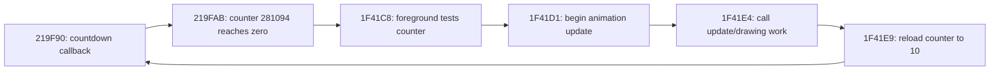

# City work timing: release, completion and timer progress

The follow-up [wait regulator prototype](wait-regulator-prototype.md) keeps work
at full configured MHz and tests bounded idle insertion at admitted empty paths.

The 33-MHz city slowdown has a concrete cause: an animation update takes longer
than the interval to the next countdown callback, and the game reloads its
countdown **after** that work finishes. Timer callbacks see the countdown already
at zero and cannot advance the next animation's countdown. This happens 28 times
in five seconds at 33 MHz, once at 66 MHz, and zero times at 133 MHz.

A separate mechanism slows the software timer itself at very low throughput:
long callbacks keep its reentry guard set, and nested timer interrupts return
without advancing the software timer accumulators. Both mechanisms matter for
CPU adaptation; a large count of empty foreground passes does not establish
timely completion of the next work episode.

## Recorded scope and method

This extends the [CPU-budget sweep](city-cpu-sweep.md) using the same portable
Vulcania snapshot. Each rate—4, 8, 33, 66 and 133 MHz—runs independently for five
guest seconds without input. The reference interpreter, device clocks and
guest-time audio draining remain unchanged.

An optional offline probe configuration records selected executed PCs, their
pre-instruction registers, before/after guest timestamps and small post-instruction
RAM ranges. IRQ entries are distinguished from execution of the interrupted PC.
SB DMA block diagnostics also supply hardware block-boundary events. The tool
does not patch guest code or put game addresses in runtime policy.

Probe observations preserve the **entire aggregate instruction/edge trace,
PCM bytes and final PNG bytes exactly** against the corresponding prior runs
without probes, for all five rates. Observations are bounded and retained under
`target/city-deadlines/`; their host cost is not a performance result.

## The animation's actual completion boundary

The decoded and observed dependency chain is:



The snapshot registers a 15,625-us period for `0x219F90`. The counter is
decremented only when positive. At zero it remains zero until the foreground
finishes its update and writes 10. The trace confirms both the writer's address
and the resulting RAM values.

Define a **cadence boundary** as the first countdown callback after the zero
transition. Reloading before it lets that callback start counting toward the
next animation; reloading after it forfeits that countdown opportunity. This
boundary is derived from the program's data flow. It is not a documented hard
VGA presentation deadline or a claim that every later reset is visibly wrong.

All times below use the guest clock. Work duration includes interruptions and
other nested work between animation start and countdown reload.

| MHz | Completed animation updates | Release → start, median / max | Work → reload, median / max | Reloads after cadence boundary | Minimum completion margin |
| ---: | ---: | ---: | ---: | ---: | ---: |
| 33 | 28 | 0.152 / 3.340 ms | 18.482 / 34.377 ms | 28 / 28 | −15.772 ms |
| 66 | 31 | 0.123 / 4.163 ms | 9.141 / 11.618 ms | 1 / 31 | −0.466 ms |
| 133 | 31 | 0.038 / 0.100 ms | 4.518 / 5.768 ms | 0 / 31 | +5.318 ms |

The first update shows the mechanism directly; timestamps are relative to the
snapshot's guest time:

| MHz | Counter reaches zero | Work starts | Countdown reloaded | Next countdown callback |
| ---: | ---: | ---: | ---: | ---: |
| 33 | 150.639 ms | 150.751 ms | 169.144 ms | 166.639 ms |
| 66 | 150.612 ms | 150.732 ms | 159.854 ms | 166.614 ms |
| 133 | 150.598 ms | 150.664 ms | 155.173 ms | 166.599 ms |

At 33 MHz the next callback arrives while work is still running. Over the full
sample, all three rates execute 313 countdown callbacks, but those callbacks
find the animation counter already zero **28 / 1 / 0 times**, respectively.
Thus the 33-MHz animation loss is not explained by fewer countdown callbacks
than at 133 MHz. The median update-start period grows from **156.078 ms** at
133 MHz to **172.065 ms** at 33 MHz, about 10.2% longer.

At 8 MHz, 14 complete updates have a median work duration of 133.139 ms and
82 countdown callbacks find zero. At 4 MHz, only four updates finish and a fifth
remains in progress at the interval end; the median completed work duration is
616.336 ms. Partial episodes are not included as complete duration samples.

The matching final image at 66 and 133 MHz in the earlier sweep concealed the
single late reload at 66 MHz. Output snapshots alone do not establish a timing
margin or a safe throughput floor.

## Where software timer time is lost

The timer handler at `0x22EFFE` tests the reentry guard at `0x263FF6`. When the
guard is already nonzero, branch `0x22F006 → 0x22F11D` acknowledges the interrupt
and returns. This path does **not** add elapsed time to callback accumulators.
The normal path adds the snapshot's 4,000-us timer increment before scheduling
callbacks and enables interrupts while those callbacks run.

| MHz | Observed timer-handler entries | Entries taking the reentry exit | In audio callback `230A10` | In palette callback's VGA wait | Other contexts | Countdown callbacks |
| ---: | ---: | ---: | ---: | ---: | ---: | ---: |
| 4 | 1,247 | 749 | 713 | 18 | 18 | 127 |
| 8 | 1,250 | 367 | 328 | 39 | 0 | 226 |
| 33 | 1,250 | 27 | 0 | 27 | 0 | 313 |
| 66 | 1,250 | 27 | 0 | 27 | 0 | 313 |
| 133 | 1,250 | 27 | 0 | 27 | 0 | 313 |

The audio classification is based on the active timer callback stack containing
the observed mixing/copy work. Palette/VGA classification additionally requires
the wait at `0x22426A..0x224283` to be active at the nested timer entry.

Even the 133-MHz reference loses 27 software-timer increments through that guard:
108 ms of nominal accumulator progress. Its VGA waits can last up to 16.002 ms.
At 8 MHz, audio work adds hundreds of such skipped increments. Consequently,
using only the slowed guest callback clock to judge lateness would hide part of
the degradation. The unchanged hardware time must remain the reference.

This audit observes handler entry and the reentry branch, not the precise moment
the PIT line asserted. It does not report a PIT assertion-to-entry latency or
interpret the three-entry difference at 4 MHz as three proved lost hardware
interrupts. Exact source-to-entry measurement would require an additional device
event probe.

### Queueing is separate from callback execution

The tool pairs each pending-callback increment at `0x22F06D` with its dispatch
at `0x22F0AC`, by slot. All observed dispatches have a matching enqueue; callback
returns at `0x22F0B2` match their active slot.

For the countdown callback, maximum enqueue-to-dispatch delay is **3.540 ms at
33 MHz**, **1.771 ms at 66 MHz**, and **0.879 ms at 133 MHz**. At 8 MHz it grows
to **15.427 ms**. These delays are additional timing information; callback count
alone does not reveal them.

## Audio has several different obligations

The hardware DMA block interval is approximately **46.440 ms**. The audit records
block-boundary diagnostics, the matching driver acknowledgement read at
`0x181E5`, mixing, copy/conversion completion and foreground service of the
software audio-work flag.

| MHz | Maximum block → ACK | Maximum block → copy completion | Maximum service-flag → foreground service start | Foreground service callbacks generated |
| ---: | ---: | ---: | ---: | ---: |
| 4 | 4.662 ms | 44.055 ms | 194.281 ms | 24 |
| 8 | 1.744 ms | 30.556 ms | 44.991 ms | 43 |
| 33 | 0.056 ms | 13.663 ms | 24.252 ms | 59 |
| 66 | 0.113 ms | 16.569 ms | 15.831 ms | 59 |
| 133 | 0.082 ms | 15.671 ms | 16.041 ms | 59 |

The first two latency columns use the 107 complete intervals between 108 DMA
block boundaries; the final interval is right-censored. Copy destinations
alternate between `0x19800` and `0x19000`, 54 completions each. Every complete
block interval contains an acknowledgement and a copy completion, including
4 MHz. This is an observed interval association, not a general proof that a
particular destination was fully refilled before DMA consumed every byte.

At 4 MHz, the copy pipeline can finish only 2.385 ms before the next block
boundary, yet the earlier capture already showed incorrect PCM. Timely ACK and
copy completion are insufficient: they can move or acknowledge stale, missing
or silent source data.

The upstream service flag at `0x283C6D` is set by `0x219F6E`, tested by the
foreground service routine and cleared at `0x21B422`. Its callback period in
the snapshot is 83,333 us, but skipped timer increments reduce generated
callbacks from 59 to 24 at 4 MHz. Observed flag-to-service delay then reaches
194.281 ms. At 8 MHz there are 43 such callbacks, while the PCM still matches the
reference in this five-second sample. Buffering can therefore conceal upstream
lateness for some time; fewer service callbacks alone is not proof of audible
failure.

This explains why monitoring only emulated PCM queue depth and DMA IRQ deadline
misses gave an incomplete picture. Exact guest source-buffer availability at
each DMA consumption event remains uninstrumented. No live playback or listening
test is claimed here.

## Implications for a generic timing model

The useful measurement is **release → start → completion**, plus progress of
the producer that releases work. For this state, the data support three distinct
signals:

1. **Completion margin:** time left before a meaningful next producer update or
   device-consumption boundary. Track tails and the minimum observed margin;
   average empty-loop share cannot substitute for it.
2. **Producer progress:** compare hardware time with accepted timer work and
   callback generation. Slow producer clocks must not make delayed work appear
   timely. Preserve the reference's existing timing losses as a baseline rather
   than assuming its missed count is zero.
3. **Pipeline freshness:** ACK, output-copy completion and upstream refill are
   separate obligations. A DMA queue can continue producing correctly timed
   samples from stale data. To prove refill timeliness, associate destination
   ranges/write generations with subsequent DMA reads.

Static graph analysis can identify release/reset writers and work-path exits;
the differential CPU sweep identifies likely repetitive regions. Runtime needs
only the resulting event boundaries, pending-work age and completion margins.
Do not reduce throughput merely because an episode still contains empty passes.
Recover when a completion margin is exhausted or producer progress degrades,
including during an IRQ-critical region that the policy does not classify as
reducible work.

The 66-MHz sample demonstrates why a reserve is useful: completed-work counts and
final pixels match 133 MHz, but the worst observed margin is already negative.
The 133-MHz minimum observed margin of 5.318 ms is evidence for this short,
input-free state, not a universal reserve or a guarantee under heavier scenes.
No controller parameters or production wait classifications were changed.

## Reproduce and inspect

```sh
RUSTFLAGS='-C target-cpu=native' cargo build -p doslet-headless \
  --example state_graph_trace --features profiling --release --locked --offline
for mhz in 4 8 33 66 133; do
  target/release/examples/state_graph_trace \
    target/heroes-states/city.pb.gz "target/city-deadlines/$mhz" \
    2500000000 "$mhz" 5000 tools/fixtures/heroes-city-deadlines.json
done
python3 tools/city_deadlines.py target/city-deadlines
```

`probes.json` contains timestamped observations and their RAM/register context.
`deadlines.json` contains paired animation episodes, timer callbacks and audio
intervals; `deadlines-summary.json` contains the statistics above. Medians use
the middle value or the mean of the middle pair; p95 uses nearest rank. Raw
timestamps remain available for reviewing tails and partial episodes.

The probe configuration is specific to this documented executable/state and is
kept outside emulator libraries. It is bounded to 128 PCs, eight small RAM ranges
and 100,000 events. The example built, passed Clippy with `-D warnings`, and all
five probe runs reproduced their earlier complete aggregate traces, PCM and PNG
bytes exactly. The analysis also checks callback pairing, countdown reload values
and unmatched animation episodes. These are real-state offline observations,
not proof of the proposed generic controller or of other gameplay scenes.
