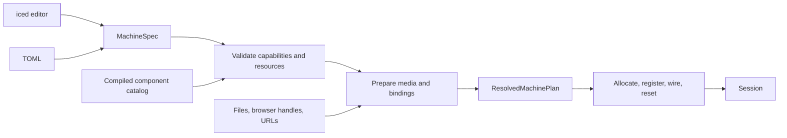
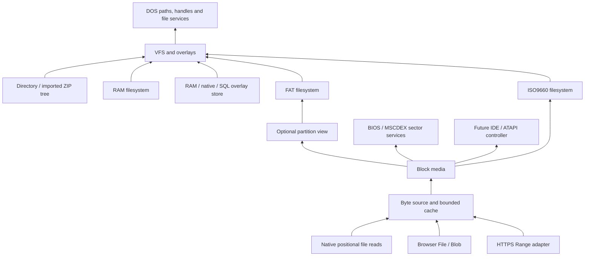

# Configurable machines, storage and the machine editor

Status: design record, 2026-10-15. The initial implementation now provides the
shared machine editor, device routes, positional ISO sources, input routing and
transactional overlays. The examples below retain the original design sketches;
use [configuration.md](../configuration.md) for the implemented profile schema.
Browser persistence uses IndexedDB. SQL remains a future adapter. Implemented
scope is documented in [architecture.md](../architecture.md) and
[SPEC.md](../SPEC.md).

## Decision

Build each machine from a validated description of components, resources, media
and mounts. Drivers declare connections during construction. The builder turns
these declarations into fixed routes and concrete Rust device instances.
Execution retains one mutable owner, static CPU bus dispatch, bounded work and
borrowed memory.

Storage separates byte acquisition from guest access. A remote ISO becomes a
byte source, block media and ISO9660 filesystem. DOS files and MSCDEX sectors
share that media and cache. Directories provide file trees without requiring a
synthetic disk image. The iced editor and TOML use one configuration model and
validator.

Input separates host sources, bindings and guest keyboard/joystick devices.
Writable overlays separate filesystem semantics from an `OverlayStore` that
can use RAM, native storage or a SQL adapter. The companion
[input and write overlay proposal](input-and-write-overlays.md) defines these
contracts, transaction boundaries and editor additions.

## Current implementation to preserve

| Component | Change |
| --- | --- |
| [`doslet-bus`](../../crates/foundation/doslet-bus/src/lib.rs) | Keep CPU-independent memory/port traits and the code-cache validity contract. |
| [`PcBus`](../../crates/machines/doslet-pc/src/io.rs) | Replace fixed address decoding with validated routes; retain typed device ownership. |
| [`Session`](../../crates/runtime/doslet-runtime/src/session.rs) | Extract service dispatch and introduce resumable storage operations. |
| [`ReadOnlyDrive`](../../crates/system/doslet-dos/src/files.rs) | Adapt the mounted tree and overlays into providers; centralize DOS handles. |
| [`doslet-iso9660`](../../crates/system/doslet-iso9660/src/lib.rs) | Separate parsing from its current whole-image `Vec<u8>` owner. |
| [`native_input`](../../apps/common/native_input.rs) | Preserve directory loading and writeback through platform adapters. |
| [`profile`](../../apps/doslet/src/profile.rs) | Preserve version-1 profiles, CLI precedence and `ro`/`rw`/`overlay` meanings. |
| [`WorkerEngine`](../../apps/doslet-web-worker/src/lib.rs) | Keep exclusive machine ownership and exchange bounded I/O messages with host adapters. |

## Construction and configuration



- `MachineSpec` contains editable intent, stable component IDs and source
  references, with no machine pointers or open handles.
- `HostBindings` resolves named installation, ROM and save locations into native
  paths or browser-selected resources. Portable profiles reference these names.
- `ResolvedMachinePlan` contains explicit resource assignments, source
  identities and reserved capacities. It is immutable during execution.

Validate before allocating the machine. Source preparation can yield. A failed
preparation preserves the existing session; installing a new hardware plan
requires restart and an explicit disposition of dirty storage. Registration is
atomic: partial resource installation never reaches execution.

The compiled catalog supplies component kinds, fields, defaults, resource
alternatives, capabilities and support status. Runtime composition selects
compiled implementations. Binary plugin loading is outside this proposal.

CPU model and execution engine are separate settings. Select them outside the
instruction loop, retaining generic bus calls inside it. Initially offer the
current i386 subset and x87 support; unimplemented CPU models stay unavailable.
Label the existing functional clock separately from future cycle-accurate timing.

## Device and card registration

A chip owns state. A card composes chips and exposes endpoints. The machine
connects cards to RAM, PIC, DMA and clocks. For example, an SB16 adapter composes
DSP/mixer functions and explicitly declares any implemented MIDI/FM endpoints.
A standalone MPU-401 remains independently selectable.

Here, a driver means the Rust adapter for emulated hardware. DOS `.SYS` drivers
remain guest programs. An illustrative registration API is:

```rust,ignore
trait RegisterDevice {
    fn register(
        &self,
        owner: DeviceId,
        resources: &mut ResourceBuilder,
    ) -> Result<(), ConfigError>;
}

resources.io(owner, dsp_ports, Access::ReadWrite, Widths::Byte, Endpoint::Dsp)?;
resources.memory(owner, aperture, MemoryKind::Mmio, Endpoint::VideoMemory)?;
resources.irq(owner, configured_irq, Trigger::Edge)?;
resources.dma(owner, dma8, TransferWidth::Byte)?;
```

Registration stores IDs and endpoint descriptions, without closures capturing
mutable devices, pointers into a movable machine or shared mutable wrappers.

| Resource | Declared properties |
| --- | --- |
| I/O | Ranges or decoded masks, read/write ownership, transfer widths, endpoint and register offsets |
| Memory | Physical range, owner/region ID, RAM/ROM/MMIO semantics, permissions, explicit aliases/bank windows |
| IRQ | Output pin, controller input, trigger semantics and permitted sharing |
| DMA | Channel, transfer width, request/acknowledge connection and address-space restrictions |
| Clock | Clock domain and next emulated deadline |

Reserve motherboard resources first. Reject overlapping exclusive claims with
both owners and the conflicting range. Intentional aliases and read/write splits
are explicit. ISA IRQ/DMA allocation is exclusive unless sharing semantics are
implemented. Automatic allocation uses stable ordering and preserves valid
existing assignments. Export the resolved values so a profile is reproducible.

Compile port routes into small route IDs selecting a concrete endpoint enum and
typed device index. An initial implementation can use two 65,536-entry `u16`
tables for read/write routes: 256 KiB total, plus endpoint records. Benchmark
against the current decoder before choosing a smaller paged representation.
Ordinary I/O must not scan every device or traverse a trait-object collection.

Memory uses page classification with subpage routes where necessary. Ordinary
RAM retains a direct path; MMIO calls the selected endpoint. A VRAM aperture
refers to the device's existing buffer. Wide transactions preserve device widths
and ordered cross-boundary effects, including documented partial failures.

Every mapping change updates `CodeCheck` address-space validity; writes through
aliases update the backing storage generation. Code views require stable,
side-effect-free memory. Generation exhaustion disables caching. CPU A20
translation and DMA physical addressing remain separate policies.

Typed device arenas and an endpoint enum preserve static dispatch. Borrow the
selected device separately from RAM and signal queues. Handlers emit typed
effects for machine wiring instead of recursively borrowing the enclosing bus.
Large buffers retain one owner; execution queues are reserved and bounded.

### IRQs, software services and observers

| Mechanism | Behavior |
| --- | --- |
| Hardware IRQ | Device output changes reach the PIC; the PIC selects the CPU vector. |
| BIOS/DOS service | Runtime registry selects a shim handler by vector and register selector. |
| Diagnostic observer | Receives bounded trace events without consuming interrupts or changing execution. |

VBE registers selected INT 10h services; MSCDEX registers selected INT 2Fh
services. Reject ambiguous selectors unless an explicit fallback chain resolves
them. Handlers return `Handled`, `Pass`, `Pending` or a typed failure.

Preserve guest IVT/IDT execution. Dispatch host services only when execution
reaches their installed shim, retaining the current real-mode approach. A
guest-installed handler runs normally and may chain to the old shim. A blanket
vector interception would break that contract. Protected-mode bridges require
their own ABI; they are not implied by real-mode registration.

Scheduler events carry device IDs and emulated timestamps with stable ordering
and finite processing budgets. Preserve the actual successful VGA-read signal
used by the existing polling acceleration.

### Keyboard and joystick endpoints

Register logical input endpoints alongside bus resources. Host keyboard,
controller and replay adapters feed a bounded `InputRouter`; bindings select the
guest endpoints. Keyboard protocol and i8042 controller state remain distinct.
A joystick's axis/button state feeds its gameport adapter, whose conversion
deadlines use guest time. Host sampling does not run from I/O callbacks.

Preserve the current BIOS keyboard injection as an explicit compatibility path
until hardware delivery is available. Each key uses one delivery path. Capture
loss, disconnects and queue overflow have explicit release/resynchronization
rules; they must not leave held keys behind. See the
[input pipeline](input-and-write-overlays.md#input-pipeline) for details.

## Storage layers



| Layer | Responsibility |
| --- | --- |
| Byte source | Identity, byte length and positional reads/writes; host requests when needed |
| Block media | Sector geometry, media generation, read-only/removable state |
| Partition view | Checked LBA translation into a bounded region of the same media |
| Filesystem | Nodes, directories, extents, metadata and filesystem operations |
| VFS | Mount IDs, provider routing, coherent namespaces and overlays |
| DOS adapter | Drive letters, per-drive current directories, DOS paths, handles and errors |

Distinguish byte sources from file-tree sources in the type system. Directory
and imported-ZIP providers implement filesystem operations directly. Booting
from these trees would require an additional virtual-disk feature. A disk image
can expose one media object through both controller/BIOS and filesystem paths;
raw writes must invalidate filesystem metadata and cached blocks coherently.

Refactor ISO9660 into bounded sector parsing over a provider. Begin with an
adapter over its current in-memory owner, then add positional files and remote
cache. Store small node records with media IDs and extents; validate all extents
against the known media length before reading. ISO support uses 2048-byte sectors;
raw CD formats and audio tracks need separate explicitly supported formats.

Centralize DOS handles. Each references an open-file description containing
mount generation, node ID, offset, access mode and sharing state. Duplicate
handles share the appropriate description. Providers take explicit offsets;
they do not allocate their own DOS handle-number ranges. DOS resolves `C:FILE`,
`C:\FILE`, relative paths, wildcard searches and character devices such as `CON`
before provider operations.

Media replacement invalidates stale handles using generations. A CD mount
connects files and MSCDEX to the same media/cache. Directory mounts expose file
access only; they do not implicitly install an IDE controller or BIOS disk.

### Writes

Offer **Read only**, **Temporary changes** and **Persistent changes**. Persistent
mode identifies its destination: a writable host directory or a separate save
store. Preserve the current version-1 policy on import.

- `OverlayFs(lower, upper)` merges files, including creation, deletion markers,
  truncation and rename. Reads, metadata and directory enumeration must agree.
- `CowBlockMedia(base, journal)` records changed sectors. Filesystem and raw disk
  accesses use the same merged media.

An overlay upper layer persists changed chunks, node metadata and deletion
records through `OverlayStore`. SQL is one possible host adapter, with atomic
namespace/content changes and idempotent mutation IDs. DOS and the lower
filesystem remain independent of that choice. The
[overlay contract](input-and-write-overlays.md#writable-overlay-filesystem)
defines read precedence, truncation, rename, recovery and writer ownership.

Keep HTTPS ISO media immutable. Saves use another writable mount. Initially
reject file overlays over media simultaneously exposed as raw CD sectors,
because the two access paths would otherwise disagree.

Reserve overlay/journal capacity outside guest execution. Persistence uses
bounded host requests; a full queue yields. Quota or flush failures remain
visible. In persistent mode, guest close/commit waits for the host adapter to
acknowledge its write batch; acknowledgement follows the strongest flush the
backend provides and does not promise protection from browser storage eviction.
Reset drains pending writes or preserves their owner for recovery/export after
a failure. Browser save export remains available independently of automatic
persistence.

## Resumable storage operations

Keep CPU memory/port contracts synchronous. Retrying a partially executed
instruction after a generic `Pending` bus error could duplicate side effects.
Instead, storage and BIOS/DOS services retain explicit continuations:

```rust,ignore
enum IoStep<T> {
    Ready(T),
    NeedHost(HostRequest),
    Yield, // Bounded local parsing/copying work completed.
}

struct HostRequest {
    session_epoch: u64,
    id: RequestId,
    operation: HostOperation,
}

enum HostOperation {
    ReadSource {
        source: SourceId,
        media_generation: u64,
        offset: u64,
        length: u32,
        buffer: BufferSlot,
    },
    Overlay {
        store: StoreId,
        store_generation: u64,
        command: StoreCommand, // Typed read or bounded transaction; no SQL text.
    },
}
```

Errors remain a separate `Result`. Use checked `u64` source offsets on WASM32 as
well as native, converting to buffer indices after bounds checks. JS bridges
must preserve exact offset integers.

For a DOS read that misses the cache:

1. Retain the service state, handle position and guest destination descriptor.
   Obtain the complete bounded transfer before committing guest output.
   Directory traversal yields with its own retained cursor.
2. Return `WaitingForIo` and a host request. Keep run/pause intent separate from
   this wait condition.
3. Fetch into an owned buffer and return its ID and generations. No RAM or cache
   borrow survives the host boundary.
4. Validate the completion, install data and resume the same operation. Copy to
   guest RAM and advance the handle offset once, then return through the shim.

Initially freeze guest CPU and device time during external waits. UI and fetch
events continue; committed audio drains, followed by host silence. Rebase host
pacing on resume so network delays do not become guest timer ticks or catch-up
execution. A user pause remains in effect after completion. Reset cancels work
on discardable reads and rejects late completions by epoch. Persistent commits
must settle or be reconciled with the store before another writer starts;
dropping a completion cannot undo a committed transaction.

Future IDE/ATAPI commands can schedule completion at guest deadlines and reuse
the same media protocol. An unavailable host block at the deadline requires an
explicit wait policy. `Cpu::step` still does not become asynchronous.

Ready operations borrow cache spans only for the duration of the operation.
Pin those slots, coalesce duplicate misses and apply backpressure when the pool
is full. Transport-to-cache and cache-to-guest copies are explicit; no whole
ISO copy or long-lived cross-task buffer borrow is required.

## HTTPS ISO in web mode

Use a platform `HttpRangeSource`; Rust/WASM owns cache/operation state and Fetch
performs network work. Preserve local file selection as a complete fallback.

HTTP permits ignoring Range. Single-part `206` uses `Content-Range` to identify
its interval; `Content-Length` describes the response body. `If-Match` compares
strong validators and can fail with `412`; a changed `If-Range` validator can
instead result in a full response. Choose `Range` plus `If-Match` for mounted
media. [RFC 9110](https://www.rfc-editor.org/rfc/rfc9110.html#name-range-requests)

Proposed policy:

- Probe with `GET` and `Range: bytes=0-65535`. Require `206`; check the requested
  interval (allowing clipping at EOF), exact byte count, known total length and
  strong ETag. HEAD/Accept-Ranges alone do not pass.
- Pin the resolved HTTPS URL, length, representation and validator as source
  identity. Validate each completion before caching it; send `If-Match` on
  subsequent requests. ETags identify versions, not cryptographic integrity.
- Reject `200`, inconsistent bounds, unexpected encoding or changed identity in
  streaming mode. Cancel unexpected bodies. A separate bounded full-download
  action can be added without silently changing the streaming policy.
- Treat `412` as changed media and `416` as a failed range/length contract.
  Require a new mount decision instead of mixing old/new sectors. Initial
  streaming requires a strong ETag; a verified chunk manifest could later
  support sources without one.

A single bounded Range can be CORS-safelisted; `If-Match` needs preflight
permission. Expose `Content-Range`, `ETag` and `Content-Encoding`. Application
code cannot set `Accept-Encoding`; Fetch controls it and specifies identity
encoding for Range requests. [Fetch Standard](https://fetch.spec.whatwg.org/#http-cors-protocol)

Proposed public-media contract with `credentials: omit`:

```http
Access-Control-Allow-Origin: https://doslet.example
Access-Control-Allow-Methods: GET, HEAD
Access-Control-Allow-Headers: Range, If-Match
Access-Control-Expose-Headers: Content-Range, ETag, Content-Encoding, Accept-Ranges
```

The server handles OPTIONS, includes applicable CORS headers on data/error
responses and serves an uncompressed stable representation. When Fetch hides
the cause, report a transport/CORS failure rather than inventing a diagnosis.

These are initial tuning proposals, to be measured with games:

| Parameter | Starting value |
| --- | --- |
| Aligned cache chunk | 128 KiB |
| RAM data budget | 16 MiB, including reserved/in-flight cache slots |
| Concurrent requests | 4, with demand reads prioritized |
| Sequential prefetch | At most two following chunks; stop on a seek |
| Attempts | 3 total, with 250-ms and 1-s retry delays |
| Time limits | 10 s per attempt; 35 s overall, including delays |

Retry transient failures within both limits. Permanent protocol/media errors
do not retry automatically. Manual Retry starts another bounded budget against
the same identity. A restarted session probes identity again; exhaustion never
creates an automatic unbounded retry cycle.

An optional OPFS cache uses media identity plus chunk index. Publish valid-cache
metadata after writing its data. Budget metadata and transfer overhead as well.
Cache quota failure falls back to RAM; save-data failure remains explicit.
Browser storage can be cleared or evicted, so cached media and saves have
different UI treatment. [Browser storage documentation](https://developer.mozilla.org/en-US/docs/Web/API/File_System_API/Origin_private_file_system)

## Profile model

Version 1 translates to this model. Version 2 adds hardware and a storage graph.
Reject duplicate IDs, cycles, incompatible references and unsupported kinds.
Drafts may have unresolved bindings; starting requires a valid resolved plan.
The editor hides intermediate nodes behind a simple drive wizard.

Illustrative future profile; the current parser does not accept it:

```toml
version = 2
name = "Heroes"

[machine]
platform = "pc-at"
memory_mib = 16
firmware = "dos-services"

[machine.cpu]
model = "i386"
engine = "interpreter"
fpu = "x87-subset"
timing = "functional"
clock_hz = 33000000

[[devices]]
id = "video0"
kind = "vga-vbe101"
vram_kib = 512

[[devices]]
id = "sound0"
kind = "sb16"
io_base = 0x220
irq = 7
dma8 = 1
dma16 = 5

[[devices]]
id = "midi0"
kind = "mpu401-uart"
io_base = 0x330

[[sources]]
id = "installation"
kind = "directory"
binding = "game-files"

[[sources]]
id = "disc-url"
kind = "https-range"
url = "https://media.example/heroes.iso"
identity = "strong-etag"
cache_mib = 16

[[media]]
id = "disc"
kind = "cdrom"
source = "disc-url"
sector_bytes = 2048

[[filesystems]]
id = "game-tree"
kind = "directory"
source = "installation"

[[filesystems]]
id = "disc-files"
kind = "iso9660"
media = "disc"

[[mounts]]
drive = "C"
filesystem = "game-tree"
write_mode = "persistent-overlay"
save_binding = "heroes-saves"

[[mounts]]
drive = "D"
filesystem = "disc-files"
expose = "mscdex"
write_mode = "read-only"

[launch]
executable = 'C:\HEROES.EXE'
working_directory = 'C:\'
arguments = []

[outputs.audio]
enabled = true

[outputs.midi]
source = "midi0"
game_mode = "gm"
renderer = "rust"
```

`persistent-overlay` resolves into an upper filesystem and merged mount.
Its binding can name a native save directory or managed browser store, including
the proposed SQL adapter. An explicit `save_store` can reference a named store
with a stable save namespace; `save_binding` remains a shorthand. Existing native
writeback into a selected source remains a separate policy. Match save overlays
and caches to their base-media identity. Profiles contain references, not
embedded installation files, ROMs or credentials.

## Machine editor

Open **Configure machine** from the workspace. Edit a draft with **Save profile**
and **Start machine** actions. Offer implemented presets with editable components.

```text
  Heroes                                      [Save profile] [Start machine]

  Overview       CPU and memory
  CPU & memory   CPU       [i386               v]  FPU [x87 subset v]
  Video          Memory    [16 MiB             v]
  Sound          Timing    [Functional, 33 MHz  v]
  Input
  Drives
  Other devices  Installed components
  Resources      VGA / VBE 101h       512 KiB                  [Edit]
                 Sound Blaster 16    220h · IRQ 7 · DMA 1/5   [Edit]
                 MPU-401 UART        330h                     [Edit]
                                                             [+ Add]

                 Drives
                 C:  Game files    Folder       Persistent changes [Edit]
                 D:  Heroes CD     HTTPS ISO    Read only          [Edit]
                                                           [+ Drive]

                 No resource conflicts. Disc source checked.
```

Use readable component cards with ports/IRQ/DMA under **Advanced**. The
**Resources** page shows I/O, memory, IRQ and DMA maps, including motherboard
reservations. A conflict links to both editors and an available alternative.

The drive wizard asks for letter/kind, source (folder, imported ZIP, local image
or HTTPS image), filesystem/partition, then write policy and save destination.
Remote sources show **Check source**, progress and cache use. Offer **Make
available offline** only once that feature exists. Put protocol diagnostics in
expandable details; show actionable outcomes such as “Source changed”.

The **Input** page selects host controllers, keyboard delivery mode and guest
targets, with remapping, calibration, live control previews and capture policy.
The drive editor selects a save destination independently of the source. Show
pending/saved/failed status from store acknowledgements and provide export/import.
Browser SQL is an implementation choice under **On this device**; backend
diagnostics belong in details.

Guest sound cards and host outputs have separate controls. MPU-401 is guest
hardware; Rust synthesis, host MIDI ports and a ROM-backed MT-32 renderer are
output choices. Validate routing and ROM bindings separately. Multiple sound
cards are supported by the model when their resources and outputs are valid.

Catalog badges identify implemented subsets, experimental components and
unavailable choices. Names alone never imply full hardware/game compatibility.
CPU/RAM/card changes require restart. Existing live output/volume changes remain
available. Removable-media changes require a supported paused-state procedure
that flushes writes, invalidates handles and cancels requests. Import/export
TOML remains a complete manual workflow.

## Migration and acceptance

| Stage | Deliverable and acceptance |
| --- | --- |
| 1 | Configuration model, catalog, validator and version-1 adapter, including input endpoints and save bindings. Existing profiles resolve equivalently, including overrides and write policies. Add the editor shell to inspect the resolved machine. |
| 2 | Registration and resource maps. Verify widths, aliases, conflicts, IRQ/DMA and cache invalidation; compare recorded PRINCE/CIV/Heroes runs with the existing decoder. |
| 3 | DOS handles/VFS with current tree and ISO providers; separate overlay semantics and RAM store. Preserve local loading, seeks, enumeration, errors and persistence. |
| 4 | Resumable storage with an artificial delayed source and transactional store. Verify miss/yield/pause/reset/cancellation, lost/duplicate acknowledgements, recovery and exactly-once guest effects under bounded memory. |
| 5 | Positional local files and HTTPS ranges. Rust HTTP fixtures cover ignored/malformed ranges, changed media, truncation, timeouts and retry exhaustion. Real browser checks cover cross-origin Fetch/CORS. |
| 6 | Complete iced editor and browser save adapter. Exercise edit/validate/start, input mapping and save/profile import/export on desktop and web, including conflicts, unavailable options, missing bindings and storage failures. |
| 7 | Keyboard hardware delivery, gameport, additional cards, FAT and controller boot paths, each with independent tests and recorded acceptance for its advertised behavior. |

Create configuration, block/media and VFS crates when their first consumers
exist. Evolve the current ISO9660 parser. Keep chips in their hardware domains;
native/browser transports remain platform adapters. The core stays `no_std`
with iced, host files and Fetch outside CPU/chip crates. Use Cargo/Trunk and no
Node tooling.

Acceptance includes cache-hit/miss allocation boundaries, bounded queues,
unchanged manual local loading and a recorded real game reading its disc through
the browser adapter. Compilation, synthetic fixtures and a successful download
are separate evidence from game compatibility.
