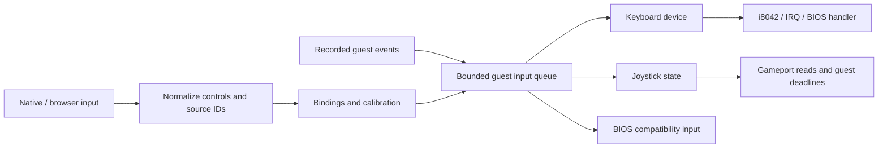
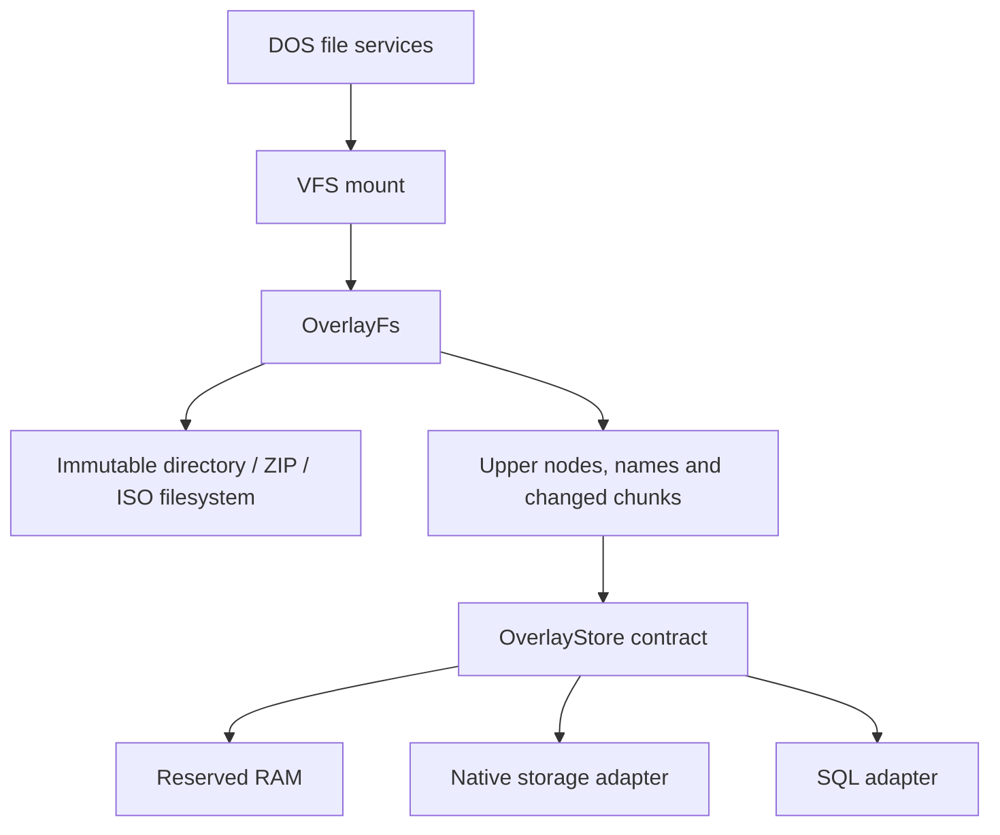

# Input devices and persistent write overlays

Status: proposal, 2026-10-15. This extends
[configurable machines](configurable-machines.md); the interfaces, profiles and
backends below are not implemented contracts.

## Decision

Separate host input, bindings and guest devices. Separately, make an overlay's
filesystem behavior independent of the place that stores its changes. Both
boundaries use bounded, typed messages and retain one owner of the machine.

The resulting extension points are:

| Abstraction | Responsibility | Example implementations |
| --- | --- | --- |
| `HostInputSource` | Report host controls and connection/focus changes | Native keyboard/controller, browser keyboard/gamepad, scripted input |
| `InputRouter` | Apply bindings and calibration to logical guest endpoints | Physical keys, gamepad axes, keyboard-to-joystick bindings |
| Guest input device | Implement the selected hardware/service protocol | AT keyboard, gameport joystick, BIOS keyboard compatibility adapter |
| `FileSystem` | Provide nodes, metadata and positional file operations | ISO9660, directory tree, RAM filesystem |
| `OverlayFs` | Merge an immutable lower filesystem with an upper layer | Game files plus private saves and configuration changes |
| `OverlayStore` | Read and atomically commit upper-layer records | Reserved RAM, native storage, SQL adapter, another transactional store |

`HostInputSource` describes an application boundary; it does not require a
trait object or host library inside the CPU. SQL connections and queries belong
to platform adapters. DOS sees the same filesystem operations with every store.

## Current behavior and migration boundary

[`keyboard::translate`](../../apps/doslet/src/keyboard.rs) converts iced keys to
BIOS scan-code/ASCII pairs. [`Session::push_key`](../../crates/runtime/doslet-runtime/src/session/keyboard.rs)
inserts those pairs into the BIOS ring. This is the compatibility input path.
[`doslet-i8042`](../../crates/hardware/controllers/doslet-i8042/src/lib.rs)
implements controller commands and bounded keyboard replies; raw keystrokes,
translation and IRQ delivery remain future work, as recorded in
[SPEC.md](../SPEC.md#dos-and-bios-contract).

The current [`Overlay`](../../crates/system/doslet-dos/src/files/overlay.rs)
owns reserved RAM and sparse patches. Its length and base-visibility rules are
useful starting points. Extract those semantics without claiming that the
current implementation already supports persistent SQL, deletion or rename.

## Input pipeline



### Events and routing

Host events carry a source ID, connection generation and monotonic sequence.
Normalized controls distinguish physical keys, text, buttons, axes and hats.
The runtime records the guest timestamp when accepting a routed event at an
execution boundary. Recorded events replay using that timestamp and order.
Replay excludes live input unless explicitly enabled.

Illustrative guest-facing values:

```rust,ignore
struct InputEvent {
    session_epoch: u64,
    source: InputSourceId,
    connection_generation: u64,
    sequence: u64,
    target: InputEndpointId,
    action: InputAction,
}

enum InputAction {
    Key { key: PhysicalKey, pressed: bool },
    Button { button: u8, pressed: bool },
    Axis { axis: u8, value: i16 },
    Hat { hat: u8, direction: HatDirection },
    ReleaseSource,
}
```

`PhysicalKey` names a physical position and distinguishes left/right modifiers;
it is independent of ASCII, DOS scan codes and host-library enums. Axis values
are normalized with a documented center, clamp and range. Text entry is a
separate bounded operation with explicit guest layout/code-page conversion.
Unsupported characters return a visible result. Hardware keyboard delivery
requires a supported key-sequence mapping; it must not inject BIOS characters
behind the hardware path.

Compile editable binding rules before execution. A source can route to several
endpoints through explicit rules. When several controls produce one key/button,
track each contributor so releasing one does not release another's held input.
Axis combinations use an explicit policy, such as summation followed by clamp.
Reject unresolved targets and ambiguous rules. Axis dead zones, inversion,
sensitivity and button thresholds are profile settings; threshold bindings use
hysteresis to avoid rapid toggling near a boundary.

Host device selection is a binding, distinct from the emulated device model.
Reconnect requires a new connection generation and an unambiguous match; never
identify a controller solely by its current enumeration index. Missing devices
leave their targets neutral and show an actionable binding state.

### Focus, queues and timing

- The game capture policy decides which events reach the guest. Editing a
  configuration field must not type into DOS. Reserve an escape from capture.
- Losing capture, disconnecting a source, pausing or replacing bindings releases
  its contributions. A reserved control slot makes release independent of a
  full ordinary queue. Resume/rebind starts neutral and requires fresh presses.
- Coalesce adjacent axis updates for the same source/target only when doing so
  preserves ordering relative to buttons and keys. Preserve press/release edges.
- On edge-queue overflow, report input loss, release the affected source and
  request a state resynchronization. Suppress held controls until released;
  do not silently leave keys pressed or claim lossless input under overload.
- During storage waits, input processing remains bounded. Focus/disconnect
  changes remain actionable; pending guest events acquire the paused guest
  timestamp and retain order when execution resumes. Reset drops old epochs.
- Ignore host repeat for physical key events. Guest keyboard/compatibility
  repeat uses guest time. Host sampling frequency does not advance hardware
  timers or produce additional guest repeats.

### Keyboard and joystick devices

Split keyboard protocol state from the i8042 controller as hardware support
grows. The keyboard owns pressed keys, scan-set encoding and repeat deadlines;
the controller owns its queues, command/status registers, translation and IRQ
connection. Register the controller's ports/IRQ with the machine builder.

The hardware route reaches the BIOS ring through the installed keyboard handler
only when that handler executes. A guest replacing it can consume raw input.
Retain the existing direct BIOS route as an explicit compatibility mode while
hardware delivery is incomplete. Exactly one mode delivers a given key; enabling
hardware input must not also call `push_key` for the same event.

Separate logical joystick state from a gameport adapter. The state holds axes,
buttons and connection status. The adapter turns it into the selected emulated
interface, including guest-time conversion deadlines. Reads use the latest
accepted state and never poll host APIs. Keyboard bindings can drive the same
logical joystick as a physical controller. A future BIOS joystick service must
refer to the same device state.

Gameport is a resource-owning component. If a sound card supplies that endpoint,
its claim participates in the same conflict checks as a standalone gameport.
Offer two-stick/four-axis layouts only with a defined hardware mapping and
recorded acceptance; do not infer them from the host controller's button count.

## Writable overlay filesystem



`OverlayFs(lower, upper)` performs namespace and content merging. Its upper
layer stores metadata, changed content and deletion records through
`OverlayStore`. A plain writable directory needs an adapter for those records;
ordinary filesystem files alone cannot express all overlay semantics.

### Read and mutation rules

1. Resolve an upper directory entry first. A whiteout (deletion record) hides a
   lower name; an opaque upper directory hides the corresponding lower subtree.
2. Otherwise resolve the immutable lower node. Opening it does not copy content.
   On mutation, create an upper node with a stable reference to its lower node.
3. Read changed chunks from upper storage. Read uncovered ranges from the lower
   node only below its retained `lower_visible_length`; other holes are zero.
4. For a partial chunk write, obtain the visible chunk before modifying it.
   Store its resulting bytes and metadata in one mutation. A proposed initial
   chunk size is 4 KiB, independent of the HTTPS cache chunk size.
5. Truncation reduces lower visibility, hides chunks beyond EOF and clears the
   truncated tail. Later extension must expose zeros, not resurrect old bytes.
6. Rename within a mount atomically updates source/destination entries and any
   required whiteout. Lower directories retain a stable lower-node reference
   under their new name. Cross-mount rename returns the defined DOS error.

Use stable node IDs so open handles survive allowed renames. DOS sharing and
deletion rules remain in the DOS/VFS layer. Normalize names according to the
guest filesystem policy; SQL collation must not silently change DOS lookup.
Directory enumeration merges names once, respecting whiteouts and case rules.
Bound its cursor storage and define its mutation behavior with the VFS API.

Namespace changes and file data must agree after recovery. Large operations can
stage records in bounded batches and atomically publish a new root/revision.
Reclaim hidden chunks later in bounded work. No write operation clones the
whole game directory or ISO.

An overlay is keyed by a stable save namespace and lower-source identity, not
the profile's display name. Image-backed lowers use their pinned media identity;
imported trees need a manifest/fingerprint. A changed base requires an explicit
reattach/migration decision. Persistent overlays require an immutable lower view
during a session. Direct writeback to a host source remains a separate policy.

### Store protocol and acknowledgement

The core passes typed operations such as `ReadNode`, `ReadChunk`, `ListEntries`
and `CommitBatch`. Their responses carry the store generation and request ID.
`CommitBatch` includes:

- save namespace and writer fencing token;
- expected committed revision;
- stable mutation ID and payload digest;
- bounded metadata/content changes, or a staged root to publish.

Borrow cached data inside the running session. Transfer owned buffer slots to
the storage adapter when it must wait; no RAM/cache borrow crosses a task
boundary. Storage errors distinguish quota, busy writer, stale revision,
missing base, corruption and unavailable transport.

In persistent mode, DOS writes can first enter a reserved dirty cache and become
visible to that session. Close/commit waits until all preceding mutations have
been acknowledged. Create/delete/rename wait for their namespace transaction
before reporting success. The cache applies backpressure before exhausting its
reserved memory. Temporary mode acknowledges the RAM store only.

An atomic batch either publishes all its changes or leaves the committed
revision unchanged. Close may flush several batches; this does not promise an
atomic save spanning several DOS calls or files. A failed flush leaves changes
dirty and exportable and returns a DOS error; the UI must not display "Saved".

Store the mutation ID and result in the same transaction as the changes. Retrying
an identical mutation after a lost acknowledgement returns its committed result;
the same ID with different content is an error. Persisted mutation identity is
independent of session/request epochs. This permits recovery after Reset without
applying a write twice. Prune deduplication history only after its recovery window
closes; an older unresolved mutation requires reconciliation instead of blind retry.

Reset cancels discardable reads, but first resolves the status of in-flight
commits. Ignoring a late commit acknowledgement does not undo the stored write.
Reopen the authoritative revision before starting another writer. Use one active
writer per save namespace, enforced by the backend and fencing token; another
tab/session can open read-only or fork a separate overlay.

At mount time, a store reports persistence/flush capabilities, transaction and
buffer limits, schema version and writer availability. Validate these against
the requested write policy before starting. A RAM store cannot satisfy a
persistent mount merely because it implements the same operations.

## SQL storage adapter

A SQL backend stores the overlay's upper records. It does not interpret DOS
interrupts, own guest RAM or query the database for every CPU instruction.
Use prepared statements behind `OverlayStore`; its public API contains typed
filesystem operations rather than arbitrary SQL strings.

An illustrative schema, with constraints and versioned migrations to be defined
during implementation:

| Table | Content |
| --- | --- |
| `stores` | Save namespace, base identity, schema version, committed revision, writer epoch |
| `nodes` | Node ID, type, attributes, length, lower-node reference, lower-visible length, opaque-directory flag |
| `dirents` | Parent node, normalized name, target node or whiteout; unique per parent/name |
| `chunks` | Node and chunk index, content version and byte payload |
| `commits` | Mutation ID, payload digest and resulting revision |

All keys include the save namespace. Changed bytes are binary values. Update
content, lengths, names, whiteouts, revision and deduplication result in the same
transaction. Check the expected revision and writer token inside that transaction.
Staged chunks are unreachable until publication; cleanup preserves anything
reachable from a committed root or an active recovery operation.

For web, the proposed local adapter is SQLite compiled to WASM with a browser
storage backend. The emulator communicates with a storage Worker using bounded
messages; a synchronous database call must not block the UI or CPU execution
owner. The runtime contract also permits another transactional browser store.
Choose the concrete SQLite/browser integration after checking its storage,
locking, deployment and build requirements against Doslet's no-Node constraint.

A remote SQL service can implement the same contract through an authenticated
application API. It is a separate optional binding with explicit server-side
persistence; browser code does not receive database credentials or upload saves
by default. Local browser storage is sufficient for the initial design.

Save data has a separate budget from the disposable ISO cache. Report persistence
capabilities and failures, preserve manual export/import, and do not silently
switch a persistent binding to temporary storage. Recovery and migration must
preserve the last committed revision. Schema upgrades run before mounting;
unsupported newer schemas fail without rewriting them.

## Configuration and editor additions

Keep guest hardware, host bindings and save destinations distinct:

| Configuration | Meaning |
| --- | --- |
| Keyboard model and delivery mode | What the guest sees; hardware or BIOS compatibility |
| Joystick/gameport model | Guest controls and bus resources |
| Input bindings | Which host controls feed those endpoints, including calibration |
| Overlay mount | Immutable lower filesystem plus a named upper store |
| Save binding | RAM, native location or browser SQL store; stable save namespace |

Illustrative additions to a future profile:

```toml
[[devices]]
id = "keyboard0"
kind = "at-keyboard"
controller = "motherboard.kbc"

[[devices]]
id = "gameport0"
kind = "gameport"
layout = "two-joysticks"

[[input_bindings]]
id = "player1"
host_binding = "player-one-controller"
target = "gameport0.joystick1"
mapping = "two-axis-two-button"
dead_zone = 0.12

[[save_stores]]
id = "heroes-saves"
binding = "player-saves"
namespace = "heroes-installation-1"

[[mounts]]
drive = "C"
filesystem = "game-tree"
write_mode = "persistent-overlay"
save_store = "heroes-saves"
```

These are proposed fields, not supported settings. The gameport resource profile
resolves explicit port claims; missing/unsupported resources fail validation.
The host binding selects the browser SQL adapter or a native destination without
changing guest paths. The existing `save_binding` shorthand expands into a named
store; specifying conflicting shorthand and explicit store is an error.

Add an **Input** page with keyboard mode, controller selection, remapping,
axis/button preview, calibration and capture settings. Show device availability
and neutralize a controller before changing its bindings. Hardware changes use
the machine restart flow; mapping changes can apply at an input boundary.

The drive editor offers **Temporary**, **On this device** and supported external
destinations, plus the read-only option. **On this device** can resolve to the
browser SQL binding. Put backend details in an expandable panel. Show pending,
saved, failed or busy state from actual acknowledgements, plus export/import.

## Implementation and acceptance

1. Extract normalized input and binding contracts while preserving the existing
   BIOS compatibility path. Record focus, disconnect and overflow behavior.
2. Implement keyboard hardware delivery and gameport independently. Acceptance
   covers raw input, guest handlers, held/released keys, repeat and calibration.
3. Extract overlay semantics with the RAM store first. Cover sparse writes,
   truncate/re-extend, creation, deletion, rename, enumeration and open handles.
4. Add resumable store operations and a transactional adapter. Exercise quota,
   busy/stale writers, lost acknowledgements, reset and crash recovery.
5. Add browser SQL binding and editor controls. Record real reload/save behavior,
   including two tabs and backend-unavailable cases, separately from fixtures.

These are future acceptance criteria; no implementation results are claimed.
Introduce small input/protocol libraries and hardware-domain crates with their
first consumers. Keep SQL/host dependencies outside `no_std` emulation libraries
and retain Cargo/Trunk without Node tooling.
